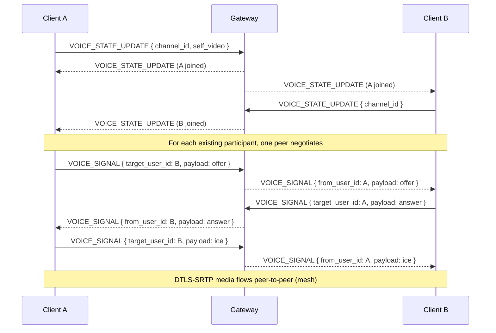

# Nebula — API Specification

| Field | Value |
| --- | --- |
| Document | API_SPECIFICATION.md |
| Status | **Implemented** — the REST API + Socket.IO gateway exist and are integration-tested (see [FINAL_ACCEPTANCE_REPORT.md](./FINAL_ACCEPTANCE_REPORT.md)); this document is the reference contract |
| Version | 0.1.0 |
| Last updated | 2026-10-19 |

> Status note: all routes and events below are **implemented** unless marked otherwise. Discord-derived contracts are marked **[VERIFIED]**; independent choices are **[DESIGN]**. Where a documented endpoint was never built, it is marked **[NOT BUILT]** rather than implied to exist.

---

## 1. Conventions

- **Base URL:** `http://localhost:4000/api` (dev). All REST paths below are relative to `/api` (there is no `/v1` prefix).
- **Realtime namespace:** Socket.IO namespace **`/gateway`** (default path `/socket.io`).
- **IDs:** 64-bit snowflakes serialized as **strings** everywhere.
- **Content types:** `application/json; charset=utf-8` for JSON; `multipart/form-data` for uploads.
- **Auth:** an opaque **session cookie** `nebula_session` (`HttpOnly`, `SameSite=Lax`, `Secure` in prod, `Path=/`). No bearer tokens in the slice.
- **CSRF:** unsafe methods (`POST/PUT/PATCH/DELETE`) on cookie auth require header `X-CSRF-Token` matching the `nebula_csrf` cookie (double-submit). **[DESIGN]**
- **Timestamps:** ISO-8601 UTC with milliseconds (e.g. `2026-10-17T12:00:00.000Z`).
- **Pagination:** cursor by snowflake `id`. `?before=<id>&after=<id>&limit=1..100` where meaningful; responses include `{ items, has_more }`.
- **Idempotency:** message creation accepts a client `nonce`; repeated sends with the same nonce return the original message. Webhook delivery accepts `X-Idempotency-Key` (scoped per webhook); a replay returns the original message with `duplicate: true`.
- **Rate limits:** enforced per user + per route bucket + a global bucket. Responses carry `x-ratelimit-limit`, `x-ratelimit-remaining` and `x-ratelimit-reset`; a `429` carries a body `{ "error": { "code": "RATE_LIMITED" }, "details": { "retryAfterMs": <ms> } }`. **[VERIFIED: header format & 429]**
- **Slowmode:** sending in a slowmode channel before the window returns `429` with `error.code = SLOWMODE_ACTIVE` and `retry_after` seconds; `BYPASS_SLOWMODE` holders are exempt. **[VERIFIED: bit 52]**

### 1.1 Error envelope

Every non-2xx JSON response:

```json
{
  "error": {
    "code": "MISSING_PERMISSIONS",
    "message": "You lack SEND_MESSAGES in this channel.",
    "details": { "permission": "SEND_MESSAGES", "channel_id": "110000000000000001" }
  },
  "request_id": "req_01J..."
}
```

`details` is optional and shape depends on `code`. The **same string codes** are used on the realtime `ERROR` event.

### 1.2 Error codes

| Code | HTTP | Meaning |
| --- | --- | --- |
| `VALIDATION_FAILED` | 400 | Body/query failed Zod validation (`details.field`) |
| `INVALID_JSON` | 400 | Request body was not valid JSON |
| `INVALID_SNOWFLAKE` | 400 | A supplied id was not a valid snowflake |
| `CANNOT_DM_SELF` / `CANNOT_FRIEND_SELF` | 400 | Self-targeted social action |
| `MESSAGE_TOO_LONG` / `MESSAGE_EMPTY` | 400 | Message content failed length/emptiness checks |
| `UNSUPPORTED_CHANNEL_TYPE` | 400 | Action not valid for the channel type |
| `UNAUTHENTICATED` | 401 | No/expired session |
| `INVALID_CREDENTIALS` | 401 | Login username/password mismatch (no user enumeration) |
| `SESSION_EXPIRED` | 401 | The session backing the request has expired |
| `INVALID_CSRF` | 403 | Missing/invalid CSRF token (double-submit) |
| `FORBIDDEN` | 403 | Generic authorization failure (e.g. not a member) |
| `MISSING_PERMISSIONS` | 403 | Lacks a required permission (`details.permission`) |
| `NOT_GUILD_MEMBER` / `CHANNEL_NOT_ACCESSIBLE` | 403 | No access to the guild/channel |
| `HIERARCHY_VIOLATION` | 403 | Acting on a role/member equal-or-above your highest |
| `BLOCKED` / `TARGET_BLOCKED_YOU` / `TARGET_BLOCKED_BY_YOU` | 403 | Blocked relationship |
| `ACCOUNT_SUSPENDED` | 403 | Account is banned/suspended |
| `NOT_FOUND` / `UNKNOWN_USER` / `UNKNOWN_GUILD` / `UNKNOWN_CHANNEL` / `UNKNOWN_MESSAGE` / `UNKNOWN_ROLE` / `UNKNOWN_INVITE` / `UNKNOWN_ATTACHMENT` | 404 | Resource missing or hidden |
| `CONFLICT` / `ALREADY_FRIENDS` / `ALREADY_MEMBER` / `ALREADY_BLOCKED` / `LAST_OWNER` | 409 | State conflict (`details.field` where relevant) |
| `PAYLOAD_TOO_LARGE` | 413 | Upload exceeds `MAX_UPLOAD_BYTES` |
| `QUOTA_EXCEEDED` | 413 | Guild storage quota reached (`details.used`, `details.limit`) |
| `UNSUPPORTED_MEDIA_TYPE` | 415 | Upload content-type not allowed |
| `RATE_LIMITED` | 429 | Rate limit hit (`details.retryAfterMs` for per-webhook / per-command buckets) |
| `SLOWMODE_ACTIVE` | 429 | Channel slowmode active |
| `INTERNAL` | 500 | Unhandled error (never leaks internals) |
| `UPSTREAM_UNAVAILABLE` | 503 | A required dependency (DB/Redis/storage/mail) is unavailable |

> **Not built (documented):** `INVALID_SIGNATURE` (webhook HMAC), `FEATURE_NOT_IMPLEMENTED` (501), `MAIL_NOT_CONFIGURED` (503) and `STORAGE_UNAVAILABLE` (503) do not exist in the running server. Webhooks use a bearer URL token only (no request signing); email flows are not implemented.

---

## 2. REST routes

Legend for **Auth**: `public` (no session), `session` (any authenticated user), `owner` (resource owner), or a permission from the 53-flag set **[VERIFIED]**.

### 2.1 Auth & sessions

| Method | Path | Auth | Request | Response |
| --- | --- | --- | --- | --- |
| `POST` | `/auth/register` | public | `{ email, username, password }` | `201` `{ user, session }` + sets cookies |
| `POST` | `/auth/login` | public | `{ email?, username?, password }` | `200` `{ user, session }` + sets cookies |
| `POST` | `/auth/logout` | session | `{}` | `204` (revokes current session, clears cookies) |
| `GET` | `/auth/sessions` | session | — | `{ items: [{ id, device_name, user_agent, ip_hash?, created_at, last_seen_at, current }] }` |
| `DELETE` | `/auth/sessions/{session_id}` | session | — | `204` |
| `POST` | `/auth/sessions/revoke-all` | session | — | `204` (revokes all others) |
| `PATCH` | `/auth/password` | session | `{ current_password, new_password }` | `204` (revokes other sessions) |
| `POST` | `/auth/password/reset/request` | public | `{ email }` | `202` normally; `503 MAIL_NOT_CONFIGURED` when SMTP unset. Always `202` for unknown email (no enumeration). |
| `POST` | `/auth/password/reset/confirm` | public | `{ token, new_password }` | `204` |
| `POST` | `/auth/verify-email` | public | `{ token }` | `204` / `503 MAIL_NOT_CONFIGURED` |

**Validation (register/login):** email (RFC-ish, ≤254), username (2–32; no `@ # :` / triple-backtick / `discord`; not `everyone`/`here`) **[VERIFIED]**, password (12–128 chars, zxcvbn-style strength advisory). Password hashed with `scrypt` N=2^15, r=8, p=1, per-user 32-byte salt, 64-byte key. **[DESIGN]**

### 2.2 Users & profiles

| Method | Path | Auth | Request/Query | Response |
| --- | --- | --- | --- | --- |
| `GET` | `/users/@me` | session | — | full self `user` (+ `email`, `flags`, `mfa_enabled`) |
| `PATCH` | `/users/@me` | session | `{ username?, display_name?, bio?, accent_color?, avatar_attachment_id? }` | updated `user` |
| `DELETE` | `/users/@me` | session | — (typed confirmation) | `204` (soft-delete + anonymize policy) |
| `GET` | `/users/{user_id}` | session | — | public `user` |
| `GET` | `/users/{user_id}/profile` | session | `?guild_id=` | `{ user, mutual_guilds, mutual_friends, member? }` |
| `PUT` | `/users/@me/avatar` | session | multipart `file` | `{ avatar_hash, avatar_url }` |
| `GET` | `/users/@me/settings` | session | — | user settings blob (appearance, notifications, voice) |
| `PATCH` | `/users/@me/settings` | session | partial settings | updated settings |
| `GET` | `/users/@me/guilds` | session | — | guilds the user is in (with permissions) |

**Public `user` shape:**
```json
{
  "id": "110000000000000000",
  "username": "mara",
  "display_name": "Mara",
  "avatar": "a_…",
  "accent_color": 5793266,
  "bot": false,
  "bio": "server owner",
  "created_at": "2026-10-17T12:00:00.000Z"
}
```

### 2.3 Relationships (friends & blocks)

| Method | Path | Auth | Request | Response |
| --- | --- | --- | --- | --- |
| `GET` | `/users/@me/relationships` | session | — | `{ items: [{ id, type, user }] }` where `type ∈ friend / blocked / incoming_request / outgoing_request` |
| `POST` | `/users/@me/relationships` | session | `{ username }` | `201` relationship (outgoing_request); `403 BLOCKED` if blocked |
| `PUT` | `/users/@me/relationships/{user_id}` | session | `{ action: "accept" \| "block" }` | updated relationship |
| `DELETE` | `/users/@me/relationships/{user_id}` | session | — | `204` (unfriend / decline / cancel / unblock) |

### 2.4 Guilds, members, roles, invites, bans

| Method | Path | Auth | Request/Query | Response |
| --- | --- | --- | --- | --- |
| `POST` | `/guilds` | session | `{ name, icon_attachment_id?, template? }` | `201` guild (creator = owner; `@everyone` role + default channels created) |
| `GET` | `/guilds/{guild_id}` | members w/ `VIEW_CHANNEL` | `?with_counts=` | guild + roles + (channel list if permitted) |
| `PATCH` | `/guilds/{guild_id}` | `MANAGE_GUILD` | `{ name?, icon_attachment_id?, system_channel_id?, default_notifications?, explicit_content_filter? }` | updated guild |
| `DELETE` | `/guilds/{guild_id}` | owner | — | `204` |
| `GET` | `/guilds/{guild_id}/channels` | `VIEW_CHANNEL` (per channel filtered) | — | `{ items: [channel] }` (channels the caller cannot view are omitted) **[VERIFIED: omitted from HTTP]** |
| `POST` | `/guilds/{guild_id}/channels` | `MANAGE_CHANNELS` | `{ name, type, parent_id?, topic?, position?, nsfw?, rate_limit_per_user?, bitrate?, user_limit? }` | `201` channel |
| `GET` | `/guilds/{guild_id}/members` | member | `?limit&after` | `{ items: [member] }` |
| `GET` | `/guilds/{guild_id}/members/{user_id}` | member | — | member |
| `PATCH` | `/guilds/{guild_id}/members/{user_id}` | self+`CHANGE_NICKNAME` or `MANAGE_NICKNAMES`; timeout needs `MODERATE_MEMBERS` | `{ nick?, communication_disabled_until? }` | updated member |
| `DELETE` | `/guilds/{guild_id}/members/{user_id}` | `KICK_MEMBERS` (hierarchy-checked) | `?reason=` | `204` |
| `PUT` | `/guilds/{guild_id}/members/{user_id}/roles/{role_id}` | `MANAGE_ROLES` | — | `204` |
| `DELETE` | `/guilds/{guild_id}/members/{user_id}/roles/{role_id}` | `MANAGE_ROLES` | — | `204` |
| `GET` | `/guilds/{guild_id}/roles` | member | — | `{ items: [role] }` |
| `POST` | `/guilds/{guild_id}/roles` | `MANAGE_ROLES` | `{ name, permissions, color?, hoist?, mentionable? }` | `201` role (cannot grant perms you lack) |
| `PATCH` | `/guilds/{guild_id}/roles` | `MANAGE_ROLES` | `[{ id, position }]` | `200` reordered roles |
| `PATCH` | `/guilds/{guild_id}/roles/{role_id}` | `MANAGE_ROLES` | partial role | updated role |
| `DELETE` | `/guilds/{guild_id}/roles/{role_id}` | `MANAGE_ROLES` | — | `204` |
| `GET` | `/guilds/{guild_id}/bans` | `BAN_MEMBERS` | — | `{ items: [{ user, reason, created_at }] }` |
| `PUT` | `/guilds/{guild_id}/bans/{user_id}` | `BAN_MEMBERS` (hierarchy) | `{ delete_message_seconds? }` | `204` |
| `DELETE` | `/guilds/{guild_id}/bans/{user_id}` | `BAN_MEMBERS` | — | `204` |
| `GET` | `/guilds/{guild_id}/audit-logs` | `VIEW_AUDIT_LOG` | `?action_type&user_id&before&after&limit` | `{ items: [audit_entry] }` |
| `GET` | `/guilds/{guild_id}/invites` | `MANAGE_GUILD` | — | `{ items: [invite] }` |
| `GET` | `/guilds/{guild_id}/voice-states` | member | — | `{ items: [voice_state] }` |
| `POST` | `/guilds/{guild_id}/reports` | member | `{ message_id?, target_user_id?, category, comment? }` | `201` report |
| `GET` | `/guilds/{guild_id}/reports` | `MANAGE_GUILD` | `?status` | `{ items: [report] }` |
| `PATCH` | `/guilds/{guild_id}/reports/{report_id}` | `MANAGE_GUILD` | `{ status }` | updated report |

**Timeout note:** `communication_disabled_until` sets `guild_members.timed_out_until`; the timeout effect on permissions (keep only `VIEW_CHANNEL` + `READ_MESSAGE_HISTORY`, owner/`ADMINISTRATOR` exempt) is applied by the permission engine. **[VERIFIED]**

### 2.5 Channels, overwrites, threads

| Method | Path | Auth | Request/Query | Response |
| --- | --- | --- | --- | --- |
| `GET` | `/channels/{channel_id}` | `VIEW_CHANNEL` (or DM recipient) | — | channel |
| `PATCH` | `/channels/{channel_id}` | `MANAGE_CHANNELS` (name/topic/etc); overwrites need `MANAGE_ROLES` | `{ name?, topic?, nsfw?, rate_limit_per_user?, bitrate?, user_limit?, position?, parent_id?, default_auto_archive_duration? }` | updated channel |
| `DELETE` | `/channels/{channel_id}` | `MANAGE_CHANNELS` (or `MANAGE_THREADS` for threads) | — | `204` |
| `PUT` | `/channels/{channel_id}/permissions/{overwrite_id}` | `MANAGE_ROLES` | `{ type: 0\|1, allow, deny }` (strings) | `204` **[VERIFIED: overwrite object]** |
| `DELETE` | `/channels/{channel_id}/permissions/{overwrite_id}` | `MANAGE_ROLES` | — | `204` |
| `GET` | `/channels/{channel_id}/invites` | `MANAGE_CHANNELS` | — | `{ items: [invite] }` |
| `POST` | `/channels/{channel_id}/invites` | `CREATE_INSTANT_INVITE` | `{ max_age?, max_uses?, temporary?, unique? }` | `201` invite |
| `POST` | `/channels/{channel_id}/typing` | `SEND_MESSAGES` or member/DM | — | `204` (also emits `TYPING_START`) |
| `GET` | `/channels/{channel_id}/pins` | `VIEW_CHANNEL` | — | `{ items: [message] }` |
| `PUT` | `/channels/{channel_id}/pins/{message_id}` | `PIN_MESSAGES` | — | `204` **[VERIFIED: bit 51]** |
| `DELETE` | `/channels/{channel_id}/pins/{message_id}` | `PIN_MESSAGES` | — | `204` |
| `POST` | `/channels/{channel_id}/messages/{message_id}/threads` | `CREATE_PUBLIC_THREADS` / `CREATE_PRIVATE_THREADS` | `{ name, auto_archive_duration?, type?, invitable? }` | `201` thread channel **[VERIFIED: thread rules]** |
| `POST` | `/channels/{channel_id}/threads` | `CREATE_PUBLIC_THREADS` / `CREATE_PRIVATE_THREADS` | `{ name, type?, auto_archive_duration?, invitable? }` | `201` thread channel |
| `PUT` | `/channels/{channel_id}/thread-members/@me` | `VIEW_CHANNEL` + thread not archived | — | `204` |
| `DELETE` | `/channels/{channel_id}/thread-members/@me` | member | — | `204` |
| `GET` | `/channels/{channel_id}/threads/archived/public` | `READ_MESSAGE_HISTORY` | `?limit&before` | `{ items: [thread], members, has_more }` |

### 2.6 Messages

| Method | Path | Auth | Request/Query | Response |
| --- | --- | --- | --- | --- |
| `GET` | `/channels/{channel_id}/messages` | `VIEW_CHANNEL` + `READ_MESSAGE_HISTORY` (in threads: +`VIEW_CHANNEL`) | `?before&after&around&limit(1..100, default 50)` | `{ items: [message] }` newest→oldest **[VERIFIED: bounds]** |
| `POST` | `/channels/{channel_id}/messages` | `SEND_MESSAGES` (`SEND_MESSAGES_IN_THREADS` in threads) | `{ content?, nonce?, tts?, message_reference?, attachment_ids?, flags?, allowed_mentions? }` | `201` message |
| `GET` | `/channels/{channel_id}/messages/{message_id}` | `VIEW_CHANNEL` | — | message |
| `PATCH` | `/channels/{channel_id}/messages/{message_id}` | author, or `MANAGE_MESSAGES` | `{ content? }` | updated message (sets `edited_timestamp`) |
| `DELETE` | `/channels/{channel_id}/messages/{message_id}` | author, or `MANAGE_MESSAGES` | — | `204` |
| `POST` | `/channels/{channel_id}/messages/bulk-delete` | `MANAGE_MESSAGES` | `{ message_ids[2..100] }` | `204` |

**Message create rules:** content ≤ 2000 chars; at least one of `content` or `attachment_ids` required; `tts` requires `SEND_TTS_MESSAGES`; when `content` is empty, `MENTION_EVERYONE`/`SEND_TTS_MESSAGES`/`ATTACH_FILES`/`EMBED_LINKS` are implicitly denied if `SEND_MESSAGES` is denied. **[VERIFIED: 2000 & implicit denies]**

**`message` DTO (abridged):**
```json
{
  "id": "110000000000000123",
  "channel_id": "110000000000000001",
  "guild_id": "110000000000000000",
  "author": { "id": "110000000000000000", "username": "mara", "avatar": "a_…", "bot": false },
  "content": "hello world",
  "type": 0,
  "flags": 0,
  "tts": false,
  "mention_everyone": false,
  "mentions": [],
  "mention_roles": [],
  "attachments": [],
  "reactions": [],
  "pinned": false,
  "message_reference": null,
  "referenced_message": null,
  "edited_timestamp": null,
  "timestamp": "2026-10-17T12:00:00.000Z"
}
```

### 2.7 Reactions

| Method | Path | Auth | Response |
| --- | --- | --- | --- |
| `PUT` | `/channels/{cid}/messages/{mid}/reactions/{emoji}/@me` | `ADD_REACTIONS` (+ `VIEW_CHANNEL`) | `204` |
| `DELETE` | `/channels/{cid}/messages/{mid}/reactions/{emoji}/@me` | session (own reaction) | `204` |
| `DELETE` | `/channels/{cid}/messages/{mid}/reactions/{emoji}/{user_id}` | `MANAGE_MESSAGES` or self | `204` |
| `GET` | `/channels/{cid}/messages/{mid}/reactions/{emoji}` | `VIEW_CHANNEL` | `{ items: [user] }` |
| `DELETE` | `/channels/{cid}/messages/{mid}/reactions/{emoji}` | `MANAGE_MESSAGES` | `204` (all for emoji) |
| `DELETE` | `/channels/{cid}/messages/{mid}/reactions` | `MANAGE_MESSAGES` | `204` (all) |

`{emoji}` is URL-encoded `name:id` for custom, or the unicode emoji for standard. **[VERIFIED: reaction shape]**

### 2.8 Direct messages

| Method | Path | Auth | Request | Response |
| --- | --- | --- | --- | --- |
| `GET` | `/users/@me/channels` | session | — | `{ items: [dm_channel] }` |
| `POST` | `/users/@me/channels` | session | `{ recipients: [user_id] }` (1 = DM `type 1`, 2+ = group `type 3`) | `200/201` dm_channel (existing 1:1 returned idempotently) |
| `PUT` | `/channels/{channel_id}/recipients/{user_id}` | group DM owner (or member with `MANAGE_CHANNELS`) | — | `204` |
| `DELETE` | `/channels/{channel_id}/recipients/{user_id}` | group DM owner | — | `204` |

### 2.9 Read state & notifications

| Method | Path | Auth | Request | Response |
| --- | --- | --- | --- | --- |
| `POST` | `/channels/{channel_id}/ack` | member | `{ message_id }` | `204` (updates `read_states`; emits `READ_STATE_UPDATE`) |
| `GET` | `/users/@me/notifications` | session | `?before&limit` | `{ items: [notification] }` |
| `POST` | `/users/@me/notifications/ack` | session | `{ ids? , up_to? }` | `204` |

### 2.10 Search

| Method | Path | Auth | Query | Response |
| --- | --- | --- | --- | --- |
| `GET` | `/guilds/{guild_id}/messages/search` | `READ_MESSAGE_HISTORY` | `q` (required), `channel_id?`, `author_id?`, `mentions?`, `has?` (`link`/`image`/`file`), `before?`, `after?`, `limit(1..25)`, `offset(≤5000)` | `{ total_results, items: [message], index_ready: true }`; `202` `{ error: { code: "INDEX_NOT_READY" }, retry_after }` when the index lags **[DESIGN]** |

### 2.11 Uploads & media

| Method | Path | Auth | Request | Response |
| --- | --- | --- | --- | --- |
| `POST` | `/channels/{channel_id}/attachments` | `ATTACH_FILES` | multipart `file`, optional `description` | `201` `attachment` (unbound; attach via message `attachment_ids`) |
| `POST` | `/users/@me/attachments` | session | multipart `file` (avatar/icon) | `201` attachment |
| `GET` | `/attachments/{attachment_id}` | `VIEW_CHANNEL` on the owning channel (DM: recipient) | — | binary; `Content-Disposition: attachment`, `X-Content-Type-Options: nosniff`, `Cache-Control: private` |
| `GET` | `/attachments/{attachment_id}/thumbnail` | same as above | — | binary thumbnail (if generated) |
| `DELETE` | `/attachments/{attachment_id}` | uploader or `MANAGE_MESSAGES` | — | `204` (frees quota) |

**Upload validation:** size ≤ `MAX_UPLOAD_BYTES`; magic-byte sniffing to determine the real type; content-type allowlist (images `png/jpeg/gif/webp`, audio, video, `text/plain`, `application/pdf`, `application/zip`, etc.); SVG/HTML rejected as inline (stored as attachment only). **[DESIGN]** Dimensions detected for images/video; quota enforced against `STORAGE_QUOTA_BYTES_PER_GUILD`.

### 2.12 Webhooks & commands

> **Implemented shape.** Webhooks are **bearer capabilities**: the high-entropy `token` in the delivery URL is the only credential and is stored **hashed** (SHA-256). There is **no HMAC request signing** and no `signing_secret`. Commands are **first-party** (a fixed server-side registry); there is no application-registration API. **[DESIGN]**

| Method | Path | Auth | Request | Response |
| --- | --- | --- | --- | --- |
| `GET` | `/channels/{channel_id}/webhooks` | `MANAGE_WEBHOOKS` | — | `{ webhooks: [webhook] }` (token/hash omitted; `tokenPrefix` only) |
| `POST` | `/channels/{channel_id}/webhooks` | `MANAGE_WEBHOOKS` | `{ name }` | `201 { webhook, token }` — `token` shown **once** |
| `PATCH` | `/guilds/{guild_id}/webhooks/{webhook_id}` | `MANAGE_WEBHOOKS` | `{ name?, avatarKey?, disabled? }` | `{ webhook }` |
| `DELETE` | `/guilds/{guild_id}/webhooks/{webhook_id}` | `MANAGE_WEBHOOKS` | — | `204` |
| `POST` | `/guilds/{guild_id}/webhooks/{webhook_id}/rotate` | `MANAGE_WEBHOOKS` | — | `{ webhook, token }` — new token shown once |
| `POST` | `/guilds/{guild_id}/webhooks/{webhook_id}/execute` | `MANAGE_WEBHOOKS` | — | `201 { message, duplicate }` (test delivery; secret never revealed) |
| `GET` | `/guilds/{guild_id}/webhooks/{webhook_id}/deliveries` | `MANAGE_WEBHOOKS` | `?limit(1..50)` | `{ deliveries: [delivery] }` |
| `POST` | `/guilds/{guild_id}/webhooks/{webhook_id}/avatar` | `MANAGE_WEBHOOKS` | multipart `file` (png/jpeg/gif/webp) | `{ webhook }` |
| `POST` | `/webhooks/{webhook_id}/{token}` | **public** (URL token) | `{ content?, username?, tts?, embeds? }` + optional `X-Idempotency-Key` | `201 { message, duplicate:false }`; `200 { message, duplicate:true }` on a replayed idempotency key |
| `GET` | `/commands` | session | `?guildId=` | `{ commands: [command] }` |
| `POST` | `/interactions` | session (per-command permission) | `{ name? , content?, channelId, invocationId?, args? }` | `200 { result: command_result }` (ephemeral flag set for private replies) |

**Delivery semantics:** the destination is the webhook's **bound channel** — the request body cannot redirect it (unknown fields are rejected). A wrong/unknown token → `401`; a **disabled** webhook → `403`; a deleted webhook → `404`. Delivery is **idempotent** per `X-Idempotency-Key` per webhook, and is limited to **30 deliveries / 10 s per webhook** (`429 RATE_LIMITED` beyond that). Embeds are validated, length-capped and stored verbatim; **no URL is ever fetched** (no link preview, no outbound HTTP → no SSRF). Lifecycle changes are written to the guild audit log (create=50, update/rotate/disable=51, delete=52).

**First-party commands:** `/ping`, `/help`, `/shrug`, `/me`, `/user`, `/server`, `/nick`, `/slowmode`, `/timeout`, `/poll`, `/topic`. Permission-gated ones require `MODERATE_MEMBERS` (`/timeout`), `MANAGE_CHANNELS` (`/slowmode`, `/topic`), `CHANGE_NICKNAME` (`/nick`) or `VIEW_CHANNEL` (`/server`). Invocation is limited to **20 / 10 s per user** and de-duplicated by `invocationId`.

**Command result:** `{ command, invocationId, channelId, content, ephemeral }`. `ephemeral:true` (default for informational commands) is returned only to the invoker; commands marked `posts:true` (`/shrug`, `/me`, `/poll`) create a normal channel message instead.

**[Not built]** `GET/POST/DELETE /applications/{id}/commands` — there is no third-party application/OAuth2 platform.

**Webhook message defaults:** `allowed_mentions` parses **users only** unless configured. **[VERIFIED: interaction/webhook default parse]**

### 2.13 Invites (public)

| Method | Path | Auth | Request | Response |
| --- | --- | --- | --- | --- |
| `GET` | `/invites/{code}` | session | `?with_counts=` | invite preview `{ code, guild, channel, inviter, approximate_member_count }` |
| `POST` | `/invites/{code}` | session | — | `200` guild (adds membership; `403` if banned; `410` if expired/maxed) |
| `DELETE` | `/invites/{code}` | inviter or `MANAGE_GUILD` | — | `204` |

### 2.14 Operational

| Method | Path | Auth | Response |
| --- | --- | --- | --- |
| `GET` | `/healthz` | public | `200 { status: "ok" }` (liveness only) |
| `GET` | `/readyz` | public (internal net) | `200 { status: "ready", components: { db, redis, storage, schema } }` or `503` |
| `GET` | `/metrics` | internal only | Prometheus text |

---

## 3. Realtime protocol (Socket.IO, namespace `/gateway`)

### 3.1 Transport & authentication
- Client connects with `io("/gateway", { withCredentials: true, transports: ["websocket", "polling"] })`. The session cookie authenticates the handshake; an invalid/absent session yields `connect_error` with `{ code: "UNAUTHENTICATED" }`.
- The gateway is **read/dispatch-oriented**: durable writes go through REST. Only ephemeral/real-time signals (typing, presence, voice state, voice signaling, read acks) are sent client→server.

### 3.2 Envelope

- **Server→client dispatch:** `{ "t": "<EVENT_NAME>", "d": { ... }, "seq": <int> }` where `seq` is a per-connection monotonic counter used for gap detection and resume. Socket.IO also uses reserved events (`connect`, `disconnect`, `connect_error`).
- **Client→server:** `{ "t": "<EVENT_NAME>", "d": { ... } }` (Socket.IO event name = `t`).

### 3.3 Client → server events

| Event | Payload | Authorization |
| --- | --- | --- |
| `GUILD_SUBSCRIBE` | `{ guild_id }` | must be a guild member |
| `GUILD_UNSUBSCRIBE` | `{ guild_id }` | member |
| `CHANNEL_SUBSCRIBE` | `{ channel_id }` | `VIEW_CHANNEL` (or DM recipient) |
| `CHANNEL_UNSUBSCRIBE` | `{ channel_id }` | recipient |
| `TYPING_START` | `{ channel_id }` | `SEND_MESSAGES` + not timed out; coalesced |
| `PRESENCE_UPDATE` | `{ status, custom_status? }` | self only |
| `READ_STATE_ACK` | `{ channel_id, message_id }` | member/recipient |
| `VOICE_STATE_UPDATE` | `{ guild_id?, channel_id \| null, self_mute?, self_deaf?, self_video?, self_stream? }` | `CONNECT` to join; `channel_id: null` leaves |
| `VOICE_SIGNAL` | `{ channel_id, target_user_id, payload: { type: "offer"\|"answer"\|"ice", sdp?, candidate?, sdpMid?, sdpMLineIndex? } }` | both users currently in the same voice channel |
| `RESUME` | `{ session_id, last_seq }` | session owner |
| `HEARTBEAT` | `{ seq? }` | session |

### 3.4 Server → client events

| Event | Payload (`d`) | Scope |
| --- | --- | --- |
| `READY` | `{ user, session_id, resume_gateway_url, guilds: [guild], dm_channels: [dm_channel], seq }` | user room |
| `RESUMED` | `{ seq }` | user room |
| `ERROR` | `{ code, message }` | user room |
| `PRESENCE_UPDATE` | `{ user_id, status, custom_status?, guild_ids? }` | mutual friends + shared guilds |
| `GUILD_CREATE` | full `guild` (channels the caller may view, roles, members) | guild room |
| `GUILD_UPDATE` | partial `guild` | guild room |
| `GUILD_DELETE` | `{ id }` | guild room |
| `GUILD_MEMBER_ADD` | `{ member, guild_id }` | guild room |
| `GUILD_MEMBER_UPDATE` | `{ guild_id, member }` (nick/roles/timeout) | guild room |
| `GUILD_MEMBER_REMOVE` | `{ guild_id, user_id }` | guild room |
| `GUILD_ROLE_CREATE` | `{ guild_id, role }` | guild room |
| `GUILD_ROLE_UPDATE` | `{ guild_id, role }` | guild room |
| `GUILD_ROLE_DELETE` | `{ guild_id, role_id }` | guild room |
| `GUILD_BAN_ADD` / `GUILD_BAN_REMOVE` | `{ guild_id, user }` | guild room (`BAN_MEMBERS`) |
| `CHANNEL_CREATE` | `{ channel }` | permitted members |
| `CHANNEL_UPDATE` | `{ channel }` | permitted members |
| `CHANNEL_DELETE` | `{ channel }` | previously permitted members (access removed) |
| `CHANNEL_RECIPIENT_ADD` / `CHANNEL_RECIPIENT_REMOVE` | `{ channel_id, user }` | DM recipients |
| `MESSAGE_CREATE` | full `message` | channel `VIEW_CHANNEL` + `READ_MESSAGE_HISTORY` |
| `MESSAGE_UPDATE` | partial `message` (includes `edited_timestamp`) | channel subscribers |
| `MESSAGE_DELETE` | `{ id, channel_id, guild_id? }` | channel subscribers |
| `MESSAGE_REACTION_ADD` | `{ user_id, channel_id, message_id, emoji, guild_id? }` | channel subscribers |
| `MESSAGE_REACTION_REMOVE` | same shape | channel subscribers |
| `MESSAGE_REACTION_REMOVE_EMOJI` | `{ channel_id, message_id, emoji, guild_id? }` | channel subscribers |
| `MESSAGE_REACTION_REMOVE_ALL` | `{ channel_id, message_id, guild_id? }` | channel subscribers |
| `PIN_ADD` / `PIN_REMOVE` | `{ channel_id, message_id, pinned_by?, pinned_at? }` | channel subscribers |
| `TYPING_START` | `{ channel_id, user_id, started_at }` | channel subscribers (except sender) |
| `READ_STATE_UPDATE` | `{ channel_id, last_read_message_id, mention_count }` | user room |
| `NOTIFICATION_CREATE` | `{ notification }` | user room |
| `RELATIONSHIP_ADD` | `{ relationship }` | user room |
| `RELATIONSHIP_UPDATE` | `{ relationship }` | user room |
| `RELATIONSHIP_REMOVE` | `{ user_id }` | user room |
| `INVITE_CREATE` / `INVITE_DELETE` | `{ invite }` / `{ code, channel_id, guild_id? }` | guild room |
| `INTERACTION_RESULT` | `{ command, invocationId, channelId, content, ephemeral }` | invoking user only (ephemeral reply) |
| `VOICE_STATE_UPDATE` | `{ voice_state }` (join/leave/mute/move) | guild room (or DM recipients) |
| `VOICE_SIGNAL` | `{ from_user_id, channel_id, payload }` | addressed to `target_user_id` only |

> **Event-name authority.** The canonical, code-generated list is [`packages/shared/src/realtime.ts`](../packages/shared/src/realtime.ts). Some names above are grouped for readability (e.g. pins are delivered as `CHANNEL_PINS_UPDATE`); `WEBHOOKS_UPDATE` is **not emitted** — the webhook console refetches on demand.

### 3.5 Key DTO shapes

```jsonc
// guild (in READY / GUILD_CREATE)
{
  "id": "110000000000000000",
  "name": "Nebula Devs",
  "icon": "a_…",
  "owner_id": "110000000000000000",
  "roles": [ { "id": "110000000000000000", "name": "@everyone", "permissions": "2199023255551", "position": 0, "hoist": false, "mentionable": false, "color": 0 } ],
  "channels": [ { "id": "110000000000000001", "type": 0, "name": "general", "position": 0, "parent_id": null, "permission_overwrites": [] } ],
  "members": [ { "user": { "id": "…", "username": "mara" }, "nick": null, "roles": [], "joined_at": "…", "timed_out_until": null } ],
  "member_count": 2
}

// channel
{ "id": "…", "guild_id": "…", "type": 0, "name": "general", "topic": null, "position": 0,
  "parent_id": null, "nsfw": false, "rate_limit_per_user": 0, "last_message_id": null,
  "permission_overwrites": [ { "id": "…", "type": 0, "allow": "1024", "deny": "2048" } ] }

// voice_state
{ "user_id": "…", "session_id": "…", "guild_id": "…", "channel_id": "…",
  "self_mute": false, "self_deaf": false, "mute": false, "deaf": false,
  "self_stream": false, "self_video": true, "suppress": false }

// reaction
{ "emoji": { "id": null, "name": "🔥" }, "count": 3, "me": true }

// attachment
{ "id": "…", "filename": "cat.png", "content_type": "image/png", "size": 40921,
  "width": 640, "height": 480, "url": "/attachments/…", "proxy_url": "/attachments/…",
  "description": null, "is_spoiler": false }

// voice signal payload
{ "type": "offer", "sdp": "v=0\r\no=- …" }
{ "type": "ice", "candidate": "candidate:…", "sdpMid": "0", "sdpMLineIndex": 0 }
```

### 3.6 Voice signaling sequence (mesh)



### 3.7 Dispatch authorization rules
- The gateway joins rooms only after the corresponding permission check; it re-checks on every membership/permission change and **removes** sockets from rooms they may no longer see.
- `VOICE_SIGNAL` is delivered only between users currently in the same voice channel; the server never broadcasts SDP to the whole channel.
- Message events require `READ_MESSAGE_HISTORY` in addition to `VIEW_CHANNEL`, matching the documented HTTP rule that a user without history permission sees no messages. **[VERIFIED]**

---

## 4. Idempotency, ordering, and errors (realtime)

- **Ordering:** clients order `MESSAGE_*` by snowflake `id`. The gateway never guarantees cross-guild ordering; per-channel order is the DB commit order.
- **Duplicates:** clients dedupe by `id`; send retries are collapsed by `nonce`.
- **Gaps:** clients detect a `seq` gap and emit `RESUME { session_id, last_seq }`; the server replays buffered events or forces a scoped re-sync.
- **Errors:** the realtime `ERROR` payload uses the same `code` values as §1.2 (e.g. `MISSING_PERMISSIONS`, `RATE_LIMITED`, `SLOWMODE_ACTIVE`).

---

## 5. Versioning & compatibility

- Path version `/api/v1`. Breaking changes require `/v2`; additive fields are non-breaking.
- Clients must ignore unknown fields and unknown events (forward compatibility).
- Permission values are always strings; clients must treat them as opaque bitfields and use the shared module for display, never as enforcement.

---

## 6. Uncertainty / open items
- **[DESIGN OPEN]** Whether `READ_STATE_ACK` is REST (`/ack`) or gateway (`READ_STATE_ACK`); both are specified, one will be canonical.
- **[UNKNOWN]** Discord's exact gateway opcode/resume handshake was not replicated; Nebula defines its own `seq`/`RESUME` mechanism.
- **[DESIGN OPEN]** Bulk reaction endpoints and the emoji URL encoding for custom emoji need a final pass against the shared emoji model.
- **[DESIGN OPEN]** Search `202 INDEX_NOT_READY` semantics are Nebula-defined (Discord documents a similar 202; parity not claimed).
