# Nebula — Database Design

| Field | Value |
| --- | --- |
| Document | DATABASE_DESIGN.md |
| Status | **Implemented** — 3 forward-only migrations create 30 tables and are applied on boot and by `npm run db:migrate` |
| Engine | PostgreSQL 16 |
| Access | Raw SQL migrations (`pg`); no ORM |
| Version | 0.1.0 |
| Last updated | 2026-10-17 |

> Status note: every table below is a **design**. No database exists. Discord-derived shapes are marked **[VERIFIED]**; independent choices are **[DESIGN]**.

---

## 1. Conventions

### 1.1 Snowflake IDs (rationale)
- All primary keys are **64-bit snowflakes**, stored as `BIGINT` and **serialized as strings** in every API/JSON payload. **[DESIGN, format inspired by Discord's documented snowflake approach]**
- Layout: `(unix_ms - EPOCH) << 22 | worker_id << 17 | process_id << 12 | increment`. 41 + 5 + 5 + 12 bits.
- Epoch: `2026-01-01T00:00:00.000Z` = `1767225600000` ms.
- **Why:** time-sortable (messages and pagination cursors order by `id` without a separate `created_at` sort), no sequence contention across nodes, no auto-increment gaps/collisions, and cursors (`before`/`after`) map directly to IDs.
- **Why `BIGINT` not `TEXT`:** native numeric ordering and compact indexes; the string conversion happens only at the serialization boundary. The Node `pg` driver returns `int8` as a string by default — repositories parse with `BigInt` and never coerce to JS `number`.
- **Permission bitfields** are also `BIGINT`: the full flag set spans bits 0–52 (bit 47 unused) with a maximum value `< 2^53`, comfortably inside signed `BIGINT`. **[VERIFIED: bits 0–52]**

### 1.2 General rules
- Timestamps: `TIMESTAMPTZ NOT NULL DEFAULT now()`; `updated_at` maintained by trigger.
- Text: `TEXT` (Postgres `TEXT` == `VARCHAR` in performance). Length/business rules via `CHECK` + application Zod.
- Soft deletes only where history matters (`users`, `messages`, `attachments`); hard deletes elsewhere.
- Enumerations: `SMALLINT` (Discord-compatible numeric codes for channel/message types) or `TEXT` + `CHECK` (open-ended statuses) — chosen per table.
- Every FK has an explicit `ON DELETE` policy (see §4).
- Indexes are created to match the documented hot paths; partial/covering indexes used where they pay off.
- Migration file naming: `NNNN_description.up.sql` / `.down.sql`, forward-only in the app (down files exist for local dev).
- Least privilege: the app connects as a non-superuser role (`nebula_app`) with DML on app tables only.

### 1.3 Discord enums reused for fidelity **[VERIFIED]**
- Channel types: `0 GUILD_TEXT`, `1 DM`, `2 GUILD_VOICE`, `3 GROUP_DM`, `4 GUILD_CATEGORY`, `5 GUILD_ANNOUNCEMENT`, `11 PUBLIC_THREAD`, `12 PRIVATE_THREAD`, `13 GUILD_STAGE_VOICE`, `15 GUILD_FORUM`. (`10`, `14`, `16` intentionally not supported in the slice.)
- Overwrite type: `0` role, `1` member. Overwrite `{id, type, allow, deny}`.
- Message flags: `CROSSPOSTED 1<<0 … SUPPRESS_NOTIFICATIONS 1<<12, IS_VOICE_MESSAGE 1<<13, HAS_SNAPSHOT 1<<14`.
- Message types: `DEFAULT 0, RECIPIENT_ADD 1, RECIPIENT_REMOVE 2, CALL 3, CHANNEL_NAME_CHANGE 4, CHANNEL_ICON_CHANGE 5, CHANNEL_PINNED_MESSAGE 6, USER_JOIN 7, …, REPLY 19, THREAD_STARTER_MESSAGE 21`.
- Thread `auto_archive_duration` ∈ {60, 1440, 4320, 10080} minutes.

---

## 2. ER diagram

```mermaid
erDiagram
  users ||--|| credentials : "has"
  users ||--o{ sessions : "has"
  users ||--o{ devices : "has"
  users ||--o{ guild_members : "joins"
  users ||--o{ messages : "authors"
  users ||--o{ audit_log_entries : "acts"
  users ||--o{ reports : "files"

  guilds ||--o{ roles : "defines"
  guilds ||--o{ guild_members : "contains"
  guilds ||--o{ channels : "owns"
  guilds ||--o{ invites : "exposes"
  guilds ||--o{ guild_bans : "enforces"
  guilds ||--o{ audit_log_entries : "logs"
  guilds ||--o{ webhooks : "has"
  guilds ||--o{ guild_emojis : "has"

  guild_members ||--o{ member_roles : "assigned"
  roles ||--o{ member_roles : "granted"

  channels ||--o{ channel_overwrites : "overrides"
  channels ||--o{ messages : "contains"
  channels ||--o{ read_states : "tracked by"
  channels ||--o{ voice_states : "hosts"
  channels ||--o{ invites : "targets"
  channels ||--o{ webhooks : "bound to"
  channels ||--o{ dm_recipients : "includes"
  channels ||--o{ threads : "parent of"
  channels ||--o{ dm_channels : "extends"

  messages ||--o{ attachments : "carries"
  messages ||--o{ reactions : "receives"
  messages ||--o{ pins : "pinned via"
  messages ||--o{ notifications : "triggers"

  applications ||--o{ slash_commands : "declares"

  users ||--o{ friend_requests : "sends/receives"
  users ||--o{ friendships : "friends"
  users ||--o{ blocks : "blocks"
```

Not all FK links are drawn (to keep the diagram legible); the authoritative list is in §3.

---

## 3. Schema

### 3.1 Identity & accounts

#### `users`
| Column | Type | Constraints | Notes |
| --- | --- | --- | --- |
| `id` | `BIGINT` | PK | snowflake |
| `username` | `TEXT` | NOT NULL, `CHECK (char_length(username) BETWEEN 2 AND 32)` | display casing preserved |
| `username_normalized` | `TEXT` | NOT NULL | lower-cased; unique below |
| `display_name` | `TEXT` | NULL, `CHECK (char_length(display_name) <= 32)` | |
| `email_normalized` | `TEXT` | NOT NULL | lower-cased |
| `email_display` | `TEXT` | NOT NULL | as entered |
| `password_algo` | `TEXT` | NOT NULL DEFAULT `'scrypt'` | |
| `avatar_hash` | `TEXT` | NULL | |
| `accent_color` | `INTEGER` | NULL | 0–0xFFFFFF |
| `bio` | `TEXT` | NULL, `CHECK (char_length(bio) <= 190)` | "about me" |
| `bot` | `BOOLEAN` | NOT NULL DEFAULT false | |
| `system` | `BOOLEAN` | NOT NULL DEFAULT false | |
| `flags` | `BIGINT` | NOT NULL DEFAULT 0 | bitfield |
| `mfa_enabled` | `BOOLEAN` | NOT NULL DEFAULT false | |
| `verified` | `BOOLEAN` | NOT NULL DEFAULT false | always false in slice (no email) |
| `locale` | `TEXT` | NOT NULL DEFAULT `'en-US'` | i18n readiness |
| `last_known_presence` | `TEXT` | NOT NULL DEFAULT `'offline'` | Redis fallback |
| `created_at` | `TIMESTAMPTZ` | NOT NULL DEFAULT now() | |
| `updated_at` | `TIMESTAMPTZ` | NOT NULL DEFAULT now() | |
| `deleted_at` | `TIMESTAMPTZ` | NULL | soft delete / anonymization |

- **Unique:** `UNIQUE (username_normalized)`; `UNIQUE (email_normalized)`.
- **Checks:** reserved usernames — `CHECK (username_normalized NOT IN ('everyone','here'))`; forbidden characters (`@`, `#`, `:`, backtick, and the substring `discord`) enforced in application validation and additionally by a `CHECK` using `NOT (username_normalized ~ '[@#:`]|discord')` (kept in sync with the shared Zod schema). **[VERIFIED: rules]**
- **Indexes:** `idx_users_created_at (created_at)`; trigram index `idx_users_username_trgm USING gin (username_normalized gin_trgm_ops)` for prefix search.

#### `credentials` (password material split from profile)
| Column | Type | Constraints | Notes |
| --- | --- | --- | --- |
| `user_id` | `BIGINT` | PK, FK → `users(id)` **ON DELETE CASCADE** | 1:1 |
| `password_hash` | `TEXT` | NOT NULL | encoded `scrypt$N$r$p$salt$hash` |
| `updated_at` | `TIMESTAMPTZ` | NOT NULL DEFAULT now() | |

> Split so profile reads never touch password material, and so a future external-identity table can attach without widening `users`.

#### `devices`
| Column | Type | Constraints |
| --- | --- | --- |
| `id` | `BIGINT` | PK |
| `user_id` | `BIGINT` | NOT NULL, FK → `users(id)` ON DELETE CASCADE |
| `name` | `TEXT` | NULL |
| `platform` | `TEXT` | NULL (`web`,`ios`,`android`,`desktop`) |
| `last_seen_at` | `TIMESTAMPTZ` | NOT NULL DEFAULT now() |
| `created_at` | `TIMESTAMPTZ` | NOT NULL DEFAULT now() |

- **Indexes:** `idx_devices_user (user_id, last_seen_at DESC)`.

#### `sessions`
| Column | Type | Constraints | Notes |
| --- | --- | --- | --- |
| `id` | `BIGINT` | PK | snowflake (not the token) |
| `user_id` | `BIGINT` | NOT NULL, FK → `users(id)` ON DELETE CASCADE | |
| `device_id` | `BIGINT` | NULL, FK → `devices(id)` ON DELETE SET NULL | |
| `token_hash` | `BYTEA` | NOT NULL | SHA-256 of the opaque cookie value |
| `csrf_hash` | `BYTEA` | NOT NULL | SHA-256 of the CSRF token |
| `user_agent` | `TEXT` | NULL | |
| `ip_hash` | `BYTEA` | NULL | hashed, never raw (privacy) |
| `created_at` | `TIMESTAMPTZ` | NOT NULL DEFAULT now() | |
| `last_seen_at` | `TIMESTAMPTZ` | NOT NULL DEFAULT now() | |
| `expires_at` | `TIMESTAMPTZ` | NOT NULL | TTL (`SESSION_TTL_DAYS`, default 30) |
| `revoked_at` | `TIMESTAMPTZ` | NULL | |

- **Unique:** `UNIQUE (token_hash)`.
- **Indexes:** `idx_sessions_user (user_id, expires_at DESC)`; `idx_sessions_expires (expires_at)` (cleanup); partial `idx_sessions_active ON sessions(user_id) WHERE revoked_at IS NULL`.

### 3.2 Relationships

#### `friend_requests`
| Column | Type | Constraints |
| --- | --- | --- |
| `id` | `BIGINT` | PK |
| `sender_id` | `BIGINT` | NOT NULL, FK → `users(id)` ON DELETE CASCADE |
| `recipient_id` | `BIGINT` | NOT NULL, FK → `users(id)` ON DELETE CASCADE |
| `status` | `TEXT` | NOT NULL DEFAULT `'pending'`, `CHECK (status IN ('pending','accepted','declined','cancelled'))` |
| `created_at` | `TIMESTAMPTZ` | NOT NULL DEFAULT now() |
| `responded_at` | `TIMESTAMPTZ` | NULL |

- **Checks:** `CHECK (sender_id <> recipient_id)`.
- **Unique:** partial `UNIQUE (sender_id, recipient_id) WHERE status = 'pending'`.
- **Indexes:** `idx_fr_recipient (recipient_id, status)`; `idx_fr_sender (sender_id, status)`.

#### `friendships` (symmetric, stored as ordered pair)
| Column | Type | Constraints |
| --- | --- | --- |
| `user_low_id` | `BIGINT` | NOT NULL, FK → `users(id)` ON DELETE CASCADE |
| `user_high_id` | `BIGINT` | NOT NULL, FK → `users(id)` ON DELETE CASCADE |
| `created_at` | `TIMESTAMPTZ` | NOT NULL DEFAULT now() |

- **PK:** `(user_low_id, user_high_id)`; **Check:** `user_low_id < user_high_id`.
- Ordered-pair storage guarantees one row per friendship and makes both directions a single lookup.
- **Indexes:** `idx_friendship_high (user_high_id)`.

#### `blocks` (directional)
| Column | Type | Constraints |
| --- | --- | --- |
| `blocker_id` | `BIGINT` | NOT NULL, FK → `users(id)` ON DELETE CASCADE |
| `blocked_id` | `BIGINT` | NOT NULL, FK → `users(id)` ON DELETE CASCADE |
| `created_at` | `TIMESTAMPTZ` | NOT NULL DEFAULT now() |

- **PK:** `(blocker_id, blocked_id)`; **Check:** `blocker_id <> blocked_id`.
- **Indexes:** `idx_blocks_blocked (blocked_id)` (used to reject inbound DM/request).

### 3.3 Guilds, roles, members

#### `guilds`
| Column | Type | Constraints |
| --- | --- | --- |
| `id` | `BIGINT` | PK |
| `name` | `TEXT` | NOT NULL, `CHECK (char_length(name) BETWEEN 2 AND 100)` |
| `icon_hash` | `TEXT` | NULL |
| `owner_id` | `BIGINT` | NOT NULL, FK → `users(id)` **ON DELETE RESTRICT** |
| `system_channel_id` | `BIGINT` | NULL, FK → `channels(id)` ON DELETE SET NULL (added after channels) |
| `default_notifications` | `SMALLINT` | NOT NULL DEFAULT 0, `CHECK IN (0,1)` |
| `explicit_content_filter` | `SMALLINT` | NOT NULL DEFAULT 0, `CHECK IN (0,1,2)` |
| `mfa_level` | `SMALLINT` | NOT NULL DEFAULT 0, `CHECK IN (0,1)` |
| `features` | `TEXT[]` | NOT NULL DEFAULT `'{}'` |
| `max_members` | `INTEGER` | NOT NULL DEFAULT 250000 |
| `created_at` / `updated_at` | `TIMESTAMPTZ` | NOT NULL DEFAULT now() |

- Owner deletion is `RESTRICT` — the owner must transfer or delete the guild first (a deliberate safety choice).
- **Indexes:** `idx_guilds_owner (owner_id)`.

#### `roles`
| Column | Type | Constraints | Notes |
| --- | --- | --- | --- |
| `id` | `BIGINT` | PK | **@everyone role id == guild id** |
| `guild_id` | `BIGINT` | NOT NULL, FK → `guilds(id)` ON DELETE CASCADE | |
| `name` | `TEXT` | NOT NULL, `CHECK (char_length(name) BETWEEN 1 AND 100)` | |
| `color` | `INTEGER` | NOT NULL DEFAULT 0 | |
| `hoist` | `BOOLEAN` | NOT NULL DEFAULT false | |
| `mentionable` | `BOOLEAN` | NOT NULL DEFAULT false | |
| `position` | `INTEGER` | NOT NULL DEFAULT 0 | hierarchy |
| `permissions` | `BIGINT` | NOT NULL DEFAULT 0 | bitfield |
| `managed` | `BOOLEAN` | NOT NULL DEFAULT false | |
| `icon_hash` | `TEXT` | NULL | |
| `unicode_emoji` | `TEXT` | NULL | |
| `created_at` / `updated_at` | `TIMESTAMPTZ` | NOT NULL DEFAULT now() | |

- **Unique:** `UNIQUE (guild_id, position, id)` is *not* used (positions may tie; ties break by id). Optional `UNIQUE (guild_id, name)` for human friendliness — **[DESIGN]**, off by default.
- **Indexes:** `idx_roles_guild_position (guild_id, position DESC, id)`.

#### `guild_members`
| Column | Type | Constraints |
| --- | --- | --- |
| `guild_id` | `BIGINT` | NOT NULL, FK → `guilds(id)` ON DELETE CASCADE |
| `user_id` | `BIGINT` | NOT NULL, FK → `users(id)` ON DELETE CASCADE |
| `nickname` | `TEXT` | NULL, `CHECK (char_length(nickname) <= 32)` |
| `joined_at` | `TIMESTAMPTZ` | NOT NULL DEFAULT now() |
| `timed_out_until` | `TIMESTAMPTZ` | NULL |
| `flags` | `BIGINT` | NOT NULL DEFAULT 0 |
| `premium_since` | `TIMESTAMPTZ` | NULL (reserved; unused) |

- **PK:** `(guild_id, user_id)`.
- **Indexes:** `idx_gm_user (user_id)` (list a user's guilds); `idx_gm_guild_joined (guild_id, joined_at)`; partial `idx_gm_timeout ON guild_members(timed_out_until) WHERE timed_out_until IS NOT NULL`.

#### `member_roles`
| Column | Type | Constraints |
| --- | --- | --- |
| `guild_id` | `BIGINT` | NOT NULL |
| `user_id` | `BIGINT` | NOT NULL |
| `role_id` | `BIGINT` | NOT NULL, FK → `roles(id)` ON DELETE CASCADE |
| `assigned_at` | `TIMESTAMPTZ` | NOT NULL DEFAULT now() |

- **PK:** `(guild_id, user_id, role_id)`.
- **Composite FK:** `(guild_id, user_id)` → `guild_members(guild_id, user_id)` ON DELETE CASCADE, guaranteeing membership.
- **Indexes:** `idx_member_roles_role (role_id, guild_id)`.

#### `guild_bans`
| Column | Type | Constraints |
| --- | --- | --- |
| `guild_id` | `BIGINT` | NOT NULL, FK → `guilds(id)` ON DELETE CASCADE |
| `user_id` | `BIGINT` | NOT NULL, FK → `users(id)` ON DELETE CASCADE |
| `moderator_id` | `BIGINT` | NULL, FK → `users(id)` ON DELETE SET NULL |
| `reason` | `TEXT` | NULL, `CHECK (char_length(reason) <= 512)` |
| `created_at` | `TIMESTAMPTZ` | NOT NULL DEFAULT now() |

- **PK:** `(guild_id, user_id)`.
- **Indexes:** `idx_bans_user (user_id)`.

### 3.4 Channels, overwrites, threads, DMs

#### `channels`
| Column | Type | Constraints | Notes |
| --- | --- | --- | --- |
| `id` | `BIGINT` | PK | |
| `guild_id` | `BIGINT` | NULL, FK → `guilds(id)` ON DELETE CASCADE | NULL for DM/group DM |
| `type` | `SMALLINT` | NOT NULL, `CHECK (type IN (0,1,2,3,4,5,11,12,13,15))` | **[VERIFIED]** |
| `name` | `TEXT` | NULL, `CHECK (name IS NULL OR char_length(name) BETWEEN 1 AND 100)` | NULL for type 1 |
| `topic` | `TEXT` | NULL, `CHECK (char_length(topic) <= 4096)` | ≤1024 for non-forum enforced in app |
| `position` | `INTEGER` | NOT NULL DEFAULT 0 | |
| `nsfw` | `BOOLEAN` | NOT NULL DEFAULT false | |
| `parent_id` | `BIGINT` | NULL, FK → `channels(id)` ON DELETE SET NULL | category or thread parent |
| `rate_limit_per_user` | `INTEGER` | NOT NULL DEFAULT 0, `CHECK (rate_limit_per_user BETWEEN 0 AND 21600)` | slowmode (s) |
| `bitrate` | `INTEGER` | NULL | voice |
| `user_limit` | `INTEGER` | NULL | voice |
| `rtc_region` | `TEXT` | NULL | |
| `video_quality_mode` | `SMALLINT` | NOT NULL DEFAULT 1, `CHECK IN (1,2)` | |
| `last_message_id` | `BIGINT` | NULL | |
| `last_pin_timestamp` | `TIMESTAMPTZ` | NULL | |
| `owner_id` | `BIGINT` | NULL, FK → `users(id)` ON DELETE SET NULL | group DM / thread |
| `icon_hash` | `TEXT` | NULL | group DM |
| `default_auto_archive_duration` | `SMALLINT` | NULL, `CHECK (default_auto_archive_duration IN (60,1440,4320,10080))` | |
| `flags` | `BIGINT` | NOT NULL DEFAULT 0 | |
| `created_at` / `updated_at` | `TIMESTAMPTZ` | NOT NULL DEFAULT now() | |

- **Checks:** `CHECK (parent_id IS NULL OR parent_id <> id)`; `CHECK (type <> 4 OR name IS NOT NULL)` (categories need names).
- **Indexes:** `idx_channels_guild_position (guild_id, position, id)`; `idx_channels_parent (parent_id)`; `idx_channels_guild_type (guild_id, type)`.

#### `channel_overwrites`
| Column | Type | Constraints | Notes |
| --- | --- | --- | --- |
| `channel_id` | `BIGINT` | NOT NULL, FK → `channels(id)` ON DELETE CASCADE | |
| `target_id` | `BIGINT` | NOT NULL | role id or user id (not FK — dual target) |
| `type` | `SMALLINT` | NOT NULL, `CHECK (type IN (0,1))` | 0 role, 1 member **[VERIFIED]** |
| `allow` | `BIGINT` | NOT NULL DEFAULT 0 | bitfield |
| `deny` | `BIGINT` | NOT NULL DEFAULT 0 | bitfield |
| `created_at` / `updated_at` | `TIMESTAMPTZ` | NOT NULL DEFAULT now() | |

- **PK:** `(channel_id, target_id)`.
- **Integrity note:** `type=0` ⇒ `target_id` is a role in the channel's guild; `type=1` ⇒ a user id. Since a column cannot FK two tables, integrity is enforced in the application layer and by a periodic consistency job. **[DESIGN]**
- **Indexes:** `idx_overwrites_channel (channel_id)`; `idx_overwrites_target (target_id)`.

#### `threads` (metadata; the thread itself is a `channels` row of type 11/12)
| Column | Type | Constraints |
| --- | --- | --- |
| `channel_id` | `BIGINT` | PK, FK → `channels(id)` ON DELETE CASCADE |
| `parent_channel_id` | `BIGINT` | NOT NULL, FK → `channels(id)` ON DELETE CASCADE |
| `owner_id` | `BIGINT` | NULL, FK → `users(id)` ON DELETE SET NULL |
| `archived` | `BOOLEAN` | NOT NULL DEFAULT false |
| `auto_archive_duration` | `SMALLINT` | NOT NULL DEFAULT 1440, `CHECK IN (60,1440,4320,10080)` |
| `archive_timestamp` | `TIMESTAMPTZ` | NULL |
| `locked` | `BOOLEAN` | NOT NULL DEFAULT false |
| `invitable` | `BOOLEAN` | NOT NULL DEFAULT true |
| `message_count` | `INTEGER` | NOT NULL DEFAULT 0 |
| `member_count` | `INTEGER` | NOT NULL DEFAULT 0 |
| `total_message_sent` | `INTEGER` | NOT NULL DEFAULT 0 |
| `created_at` | `TIMESTAMPTZ` | NOT NULL DEFAULT now() |

- **Indexes:** `idx_threads_parent (parent_channel_id, archived)`; `idx_threads_owner (owner_id)`.

#### `thread_members`
| Column | Type | Constraints |
| --- | --- | --- |
| `channel_id` | `BIGINT` | NOT NULL, FK → `channels(id)` ON DELETE CASCADE |
| `user_id` | `BIGINT` | NOT NULL, FK → `users(id)` ON DELETE CASCADE |
| `join_timestamp` | `TIMESTAMPTZ` | NOT NULL DEFAULT now() |
| `flags` | `INTEGER` | NOT NULL DEFAULT 0 |

- **PK:** `(channel_id, user_id)`.

#### `dm_channels` (extension of `channels` for types 1/3)
| Column | Type | Constraints | Notes |
| --- | --- | --- | --- |
| `channel_id` | `BIGINT` | PK, FK → `channels(id)` ON DELETE CASCADE | |
| `type` | `SMALLINT` | NOT NULL, `CHECK (type IN (1,3))` | |
| `owner_id` | `BIGINT` | NULL, FK → `users(id)` ON DELETE SET NULL | group DM owner |
| `name` | `TEXT` | NULL | group DM |
| `icon_hash` | `TEXT` | NULL | |
| `pair_key` | `TEXT` | NULL | `"low:high"` for type 1, else NULL |
| `created_at` | `TIMESTAMPTZ` | NOT NULL DEFAULT now() | |

- **Unique:** partial `UNIQUE (pair_key) WHERE pair_key IS NOT NULL` — guarantees a single 1:1 DM channel per user pair.
- **Indexes:** `idx_dm_owner (owner_id)`.

#### `dm_recipients`
| Column | Type | Constraints |
| --- | --- | --- |
| `channel_id` | `BIGINT` | NOT NULL, FK → `channels(id)` ON DELETE CASCADE |
| `user_id` | `BIGINT` | NOT NULL, FK → `users(id)` ON DELETE CASCADE |
| `joined_at` | `TIMESTAMPTZ` | NOT NULL DEFAULT now() |
| `last_read_message_id` | `BIGINT` | NULL |

- **PK:** `(channel_id, user_id)`.
- **Indexes:** `idx_dm_recipients_user (user_id, joined_at DESC)` (list a user's DMs).

### 3.5 Messaging

#### `messages`
| Column | Type | Constraints | Notes |
| --- | --- | --- | --- |
| `id` | `BIGINT` | PK | snowflake; ordering key |
| `channel_id` | `BIGINT` | NOT NULL, FK → `channels(id)` ON DELETE CASCADE | |
| `author_id` | `BIGINT` | NULL, FK → `users(id)` ON DELETE SET NULL | NULL for webhooks |
| `webhook_id` | `BIGINT` | NULL, FK → `webhooks(id)` ON DELETE SET NULL | |
| `content` | `TEXT` | NOT NULL DEFAULT `''`, `CHECK (char_length(content) <= 2000)` | **[VERIFIED: 2000]** |
| `type` | `SMALLINT` | NOT NULL DEFAULT 0 | message type table |
| `flags` | `BIGINT` | NOT NULL DEFAULT 0 | bitfield |
| `tts` | `BOOLEAN` | NOT NULL DEFAULT false | |
| `mention_everyone` | `BOOLEAN` | NOT NULL DEFAULT false | |
| `pinned` | `BOOLEAN` | NOT NULL DEFAULT false | denormalized from `pins` |
| `reference_message_id` | `BIGINT` | NULL, FK → `messages(id)` ON DELETE SET NULL | reply/forward/pin |
| `reference_type` | `SMALLINT` | NULL | 0 DEFAULT, 1 FORWARD **[VERIFIED]** |
| `nonce` | `TEXT` | NULL | idempotency |
| `author_snapshot` | `JSONB` | NULL | webhook author name/avatar |
| `edited_at` | `TIMESTAMPTZ` | NULL | sets `edited_timestamp` |
| `created_at` | `TIMESTAMPTZ` | NOT NULL DEFAULT now() | |
| `deleted_at` | `TIMESTAMPTZ` | NULL | soft delete (moderation trace) |
| `content_tsv` | `TSVECTOR` | GENERATED ALWAYS AS (`to_tsvector('simple', content)`) STORED | search |

- **Checks:** `CHECK (author_id IS NOT NULL OR webhook_id IS NOT NULL)`; `CHECK (type <> 0 OR char_length(content) > 0 OR ...)` relaxed (attachments-only messages allowed) — enforced in app.
- **Unique:** partial `UNIQUE (channel_id, author_id, nonce) WHERE nonce IS NOT NULL` — collapses retries.
- **Indexes:**
  - `idx_messages_channel_id_desc (channel_id, id DESC)` — **primary hot path** (paginate newest-first).
  - `idx_messages_author (author_id, id DESC)`.
  - `idx_messages_reference (reference_message_id)`.
  - `idx_messages_tsv USING gin (content_tsv)` — search.
  - `idx_messages_channel_created (channel_id, created_at)` for analytics.
- **Soft-delete semantics:** deleted messages are excluded by `WHERE deleted_at IS NULL`; a nightly worker hard-deletes tombstones older than the retention window.

#### `attachments`
| Column | Type | Constraints | Notes |
| --- | --- | --- | --- |
| `id` | `BIGINT` | PK | |
| `message_id` | `BIGINT` | NULL, FK → `messages(id)` ON DELETE CASCADE | set once attached |
| `channel_id` | `BIGINT` | NOT NULL, FK → `channels(id)` ON DELETE CASCADE | access control + quota |
| `uploader_id` | `BIGINT` | NULL, FK → `users(id)` ON DELETE SET NULL | |
| `filename` | `TEXT` | NOT NULL | |
| `content_type` | `TEXT` | NOT NULL | sniffed, not client-claimed |
| `size_bytes` | `BIGINT` | NOT NULL, `CHECK (size_bytes > 0)` | |
| `width` / `height` | `INTEGER` | NULL | detected |
| `storage_key` | `TEXT` | NOT NULL | path/key in object store |
| `sha256` | `BYTEA` | NULL | integrity / dedup |
| `description` | `TEXT` | NULL, `CHECK (char_length(description) <= 1024)` | alt text |
| `is_spoiler` | `BOOLEAN` | NOT NULL DEFAULT false | |
| `duration_secs` | `REAL` | NULL | voice messages (future) |
| `created_at` | `TIMESTAMPTZ` | NOT NULL DEFAULT now() | |
| `deleted_at` | `TIMESTAMPTZ` | NULL | |

- **Unique:** `UNIQUE (storage_key)`.
- **Indexes:** `idx_attachments_message (message_id)`; `idx_attachments_channel (channel_id)`; `idx_attachments_uploader (uploader_id)`. Quota is computed with `SUM(size_bytes) WHERE channel_id IN (guild channels)` or maintained in a `guild_storage_usage` counter table (see §5).

#### `reactions`
| Column | Type | Constraints |
| --- | --- | --- |
| `message_id` | `BIGINT` | NOT NULL, FK → `messages(id)` ON DELETE CASCADE |
| `channel_id` | `BIGINT` | NOT NULL (denormalized for fan-out) |
| `user_id` | `BIGINT` | NOT NULL, FK → `users(id)` ON DELETE CASCADE |
| `emoji_id` | `BIGINT` | NULL, FK → `guild_emojis(id)` ON DELETE CASCADE |
| `emoji_name` | `TEXT` | NULL, `CHECK (char_length(emoji_name) <= 64)` |
| `emoji_key` | `TEXT` | GENERATED ALWAYS AS (`COALESCE(emoji_id::text, emoji_name)`) STORED |
| `created_at` | `TIMESTAMPTZ` | NOT NULL DEFAULT now() |

- **PK:** `(message_id, user_id, emoji_key)`.
- **Checks:** `CHECK (emoji_id IS NOT NULL OR emoji_name IS NOT NULL)`.
- **Indexes:** `idx_reactions_message (message_id)`; `idx_reactions_user (user_id)`; `idx_reactions_channel (channel_id)`.

#### `pins`
| Column | Type | Constraints |
| --- | --- | --- |
| `channel_id` | `BIGINT` | NOT NULL, FK → `channels(id)` ON DELETE CASCADE |
| `message_id` | `BIGINT` | NOT NULL, FK → `messages(id)` ON DELETE CASCADE |
| `pinned_by` | `BIGINT` | NULL, FK → `users(id)` ON DELETE SET NULL |
| `pinned_at` | `TIMESTAMPTZ` | NOT NULL DEFAULT now() |

- **PK:** `(channel_id, message_id)`.
- **Indexes:** `idx_pins_channel (channel_id, pinned_at DESC)`.

### 3.6 Invites, voice, read state, notifications

#### `invites`
| Column | Type | Constraints | Notes |
| --- | --- | --- | --- |
| `code` | `TEXT` | PK, `CHECK (char_length(code) BETWEEN 2 AND 32)` | base62 |
| `guild_id` | `BIGINT` | NULL, FK → `guilds(id)` ON DELETE CASCADE | |
| `channel_id` | `BIGINT` | NOT NULL, FK → `channels(id)` ON DELETE CASCADE | |
| `inviter_id` | `BIGINT` | NULL, FK → `users(id)` ON DELETE SET NULL | |
| `max_age` | `INTEGER` | NOT NULL DEFAULT 86400, `CHECK (max_age BETWEEN 0 AND 604800)` | seconds; 0 = never **[VERIFIED range]** |
| `max_uses` | `INTEGER` | NOT NULL DEFAULT 0, `CHECK (max_uses BETWEEN 0 AND 100)` | 0 = unlimited **[VERIFIED range]** |
| `uses` | `INTEGER` | NOT NULL DEFAULT 0 | |
| `temporary` | `BOOLEAN` | NOT NULL DEFAULT false | |
| `created_at` | `TIMESTAMPTZ` | NOT NULL DEFAULT now() | |
| `expires_at` | `TIMESTAMPTZ` | NULL | computed from `max_age` |
| `revoked_at` | `TIMESTAMPTZ` | NULL | |

- **Indexes:** `idx_invites_guild (guild_id)`; `idx_invites_channel (channel_id)`; `idx_invites_expires (expires_at)`.

#### `voice_states` (ephemeral in spirit, persisted for crash recovery)
| Column | Type | Constraints |
| --- | --- | --- |
| `user_id` | `BIGINT` | PK, FK → `users(id)` ON DELETE CASCADE |
| `session_id` | `TEXT` | NOT NULL |
| `guild_id` | `BIGINT` | NULL, FK → `guilds(id)` ON DELETE CASCADE |
| `channel_id` | `BIGINT` | NOT NULL, FK → `channels(id)` ON DELETE CASCADE |
| `self_mute` / `self_deaf` | `BOOLEAN` | NOT NULL DEFAULT false |
| `mute` / `deaf` | `BOOLEAN` | NOT NULL DEFAULT false |
| `suppress` | `BOOLEAN` | NOT NULL DEFAULT false |
| `self_stream` / `self_video` | `BOOLEAN` | NOT NULL DEFAULT false |
| `request_to_speak_timestamp` | `TIMESTAMPTZ` | NULL |
| `joined_at` | `TIMESTAMPTZ` | NOT NULL DEFAULT now() |

- **PK `(user_id)`** encodes the real-world rule that a user is in at most one voice channel at a time; the newest connection wins. **[DESIGN]**
- **Indexes:** `idx_voice_channel (channel_id)`; `idx_voice_guild (guild_id)`.

#### `read_states`
| Column | Type | Constraints |
| --- | --- | --- |
| `user_id` | `BIGINT` | NOT NULL, FK → `users(id)` ON DELETE CASCADE |
| `channel_id` | `BIGINT` | NOT NULL, FK → `channels(id)` ON DELETE CASCADE |
| `last_read_message_id` | `BIGINT` | NULL |
| `mention_count` | `INTEGER` | NOT NULL DEFAULT 0 |
| `last_mentioned_message_id` | `BIGINT` | NULL |
| `muted` | `BOOLEAN` | NOT NULL DEFAULT false |
| `notification_level` | `SMALLINT` | NULL, `CHECK (notification_level IN (0,1,2))` |
| `updated_at` | `TIMESTAMPTZ` | NOT NULL DEFAULT now() |

- **PK:** `(user_id, channel_id)`.
- **Indexes:** `idx_read_states_user_updated (user_id, updated_at DESC)`.

#### `notifications`
| Column | Type | Constraints |
| --- | --- | --- |
| `id` | `BIGINT` | PK |
| `user_id` | `BIGINT` | NOT NULL, FK → `users(id)` ON DELETE CASCADE |
| `guild_id` | `BIGINT` | NULL, FK → `guilds(id)` ON DELETE CASCADE |
| `channel_id` | `BIGINT` | NULL, FK → `channels(id)` ON DELETE CASCADE |
| `message_id` | `BIGINT` | NULL, FK → `messages(id)` ON DELETE CASCADE |
| `type` | `SMALLINT` | NOT NULL (mention, reply, friend_request, system) |
| `payload` | `JSONB` | NOT NULL DEFAULT `'{}'` |
| `read_at` | `TIMESTAMPTZ` | NULL |
| `created_at` | `TIMESTAMPTZ` | NOT NULL DEFAULT now() |

- **Indexes:** `idx_notifications_inbox (user_id, read_at, created_at DESC)`; `idx_notifications_message (message_id)`.
- Retention: worker deletes rows older than N days (configurable).

### 3.7 Moderation & audit

#### `audit_log_entries` (append-only)
| Column | Type | Constraints | Notes |
| --- | --- | --- | --- |
| `id` | `BIGINT` | PK | snowflake |
| `guild_id` | `BIGINT` | NOT NULL, FK → `guilds(id)` ON DELETE CASCADE | |
| `actor_id` | `BIGINT` | NULL, FK → `users(id)` ON DELETE SET NULL | |
| `target_id` | `BIGINT` | NULL | user/channel/role/invite id |
| `action_type` | `SMALLINT` | NOT NULL | see action enum below |
| `reason` | `TEXT` | NULL, `CHECK (char_length(reason) <= 512)` | |
| `changes` | `JSONB` | NULL | redacted before/after |
| `created_at` | `TIMESTAMPTZ` | NOT NULL DEFAULT now() | |

- **Indexes:** `idx_audit_guild (guild_id, created_at DESC)`; `idx_audit_actor (actor_id)`; `idx_audit_action (guild_id, action_type)`.
- No `UPDATE`/`DELETE` in the app; rows are immutable.
- `action_type` subset (Nebula-defined codes): `GUILD_UPDATE 1, CHANNEL_CREATE 10, CHANNEL_UPDATE 11, CHANNEL_DELETE 12, CHANNEL_OVERWRITE_* 13–15, MEMBER_KICK 20, MEMBER_BAN_ADD 22, MEMBER_BAN_REMOVE 23, MEMBER_UPDATE 24 (nick/timeout/roles), MEMBER_ROLE_UPDATE 25, ROLE_CREATE 30, ROLE_UPDATE 31, ROLE_DELETE 32, INVITE_CREATE 40, INVITE_DELETE 42, WEBHOOK_CREATE 50, WEBHOOK_UPDATE 51, WEBHOOK_DELETE 52, MESSAGE_DELETE 72, MESSAGE_PIN 74, MESSAGE_UNPIN 75`.

#### `reports`
| Column | Type | Constraints |
| --- | --- | --- |
| `id` | `BIGINT` | PK |
| `reporter_id` | `BIGINT` | NOT NULL, FK → `users(id)` ON DELETE CASCADE |
| `guild_id` | `BIGINT` | NULL, FK → `guilds(id)` ON DELETE CASCADE |
| `channel_id` | `BIGINT` | NULL, FK → `channels(id)` ON DELETE SET NULL |
| `message_id` | `BIGINT` | NULL, FK → `messages(id)` ON DELETE SET NULL |
| `target_user_id` | `BIGINT` | NULL, FK → `users(id)` ON DELETE SET NULL |
| `category` | `TEXT` | NOT NULL (`spam`,`harassment`,`other`) |
| `comment` | `TEXT` | NULL, `CHECK (char_length(comment) <= 1000)` |
| `status` | `TEXT` | NOT NULL DEFAULT `'open'`, `CHECK IN ('open','reviewing','resolved','dismissed')` |
| `reviewed_by` | `BIGINT` | NULL, FK → `users(id)` ON DELETE SET NULL |
| `created_at` / `resolved_at` | `TIMESTAMPTZ` | |

- **Indexes:** `idx_reports_status (status, created_at)`; `idx_reports_guild (guild_id)`.

### 3.8 Integrations & expressions

#### `webhooks`
| Column | Type | Constraints | Notes |
| --- | --- | --- | --- |
| `id` | `BIGINT` | PK | |
| `guild_id` | `BIGINT` | NULL, FK → `guilds(id)` ON DELETE CASCADE | |
| `channel_id` | `BIGINT` | NOT NULL, FK → `channels(id)` ON DELETE CASCADE | |
| `creator_id` | `BIGINT` | NULL, FK → `users(id)` ON DELETE SET NULL | |
| `name` | `TEXT` | NOT NULL, `CHECK (char_length(name) BETWEEN 1 AND 80)` | |
| `avatar_hash` | `TEXT` | NULL | |
| `token_hash` | `BYTEA` | NOT NULL | SHA-256 of the URL token |
| `signing_secret` | `BYTEA` | NOT NULL | HMAC-SHA256 key for incoming requests |
| `type` | `SMALLINT` | NOT NULL DEFAULT 1, `CHECK IN (1,2)` | 1 incoming |
| `application_id` | `BIGINT` | NULL, FK → `applications(id)` ON DELETE SET NULL | |
| `created_at` | `TIMESTAMPTZ` | NOT NULL DEFAULT now() | |

- **Unique:** `UNIQUE (token_hash)`.
- **Indexes:** `idx_webhooks_channel (channel_id)`; `idx_webhooks_guild (guild_id)`.

#### `applications`
| Column | Type | Constraints |
| --- | --- | --- |
| `id` | `BIGINT` | PK |
| `owner_id` | `BIGINT` | NOT NULL, FK → `users(id)` ON DELETE CASCADE |
| `name` | `TEXT` | NOT NULL |
| `description` | `TEXT` | NULL, `CHECK (char_length(description) <= 400)` |
| `icon_hash` | `TEXT` | NULL |
| `bot_user_id` | `BIGINT` | NULL, FK → `users(id)` ON DELETE SET NULL |
| `flags` | `BIGINT` | NOT NULL DEFAULT 0 |
| `created_at` | `TIMESTAMPTZ` | NOT NULL DEFAULT now() |

- **Indexes:** `idx_applications_owner (owner_id)`.

#### `slash_commands`
| Column | Type | Constraints | Notes |
| --- | --- | --- | --- |
| `id` | `BIGINT` | PK | |
| `application_id` | `BIGINT` | NOT NULL, FK → `applications(id)` ON DELETE CASCADE | |
| `guild_id` | `BIGINT` | NULL, FK → `guilds(id)` ON DELETE CASCADE | NULL = global |
| `name` | `TEXT` | NOT NULL, `CHECK (name ~ '^[a-z0-9_-]{1,32}$')` | lowercase |
| `description` | `TEXT` | NOT NULL, `CHECK (char_length(description) BETWEEN 1 AND 100)` | |
| `options` | `JSONB` | NOT NULL DEFAULT `'[]'` | |
| `default_member_permissions` | `BIGINT` | NULL | bitfield |
| `dm_permission` | `BOOLEAN` | NOT NULL DEFAULT true | |
| `version` | `BIGINT` | NOT NULL DEFAULT 1 | |
| `created_at` / `updated_at` | `TIMESTAMPTZ` | NOT NULL DEFAULT now() | |

- **Unique:** partial `UNIQUE (application_id, name) WHERE guild_id IS NULL`; partial `UNIQUE (guild_id, application_id, name) WHERE guild_id IS NOT NULL`.
- **Indexes:** `idx_slash_commands_lookup (guild_id, name)`.

#### `guild_emojis`
| Column | Type | Constraints |
| --- | --- | --- |
| `id` | `BIGINT` | PK |
| `guild_id` | `BIGINT` | NOT NULL, FK → `guilds(id)` ON DELETE CASCADE |
| `name` | `TEXT` | NOT NULL, `CHECK (name ~ '^[a-z0-9_]{2,32}$')` |
| `animated` | `BOOLEAN` | NOT NULL DEFAULT false |
| `storage_key` | `TEXT` | NOT NULL |
| `creator_id` | `BIGINT` | NULL, FK → `users(id)` ON DELETE SET NULL |
| `created_at` | `TIMESTAMPTZ` | NOT NULL DEFAULT now() |

- **Unique:** `UNIQUE (guild_id, name)`.

### 3.9 Supporting counters

#### `guild_storage_usage`
| Column | Type | Constraints |
| --- | --- | --- |
| `guild_id` | `BIGINT` | PK, FK → `guilds(id)` ON DELETE CASCADE |
| `used_bytes` | `BIGINT` | NOT NULL DEFAULT 0, `CHECK (used_bytes >= 0)` |
| `updated_at` | `TIMESTAMPTZ` | NOT NULL DEFAULT now() |

- Maintained transactionally on upload/delete; reconciled nightly against `attachments`. Enables O(1) quota checks instead of `SUM()` on the hot path.

---

## 4. `ON DELETE` policy summary

| Relationship | Policy | Reason |
| --- | --- | --- |
| guild → channels/roles/members/invites/bans/webhooks/audit | `CASCADE` | guild is the aggregate root |
| channel → messages/overwrites/pins/threads/webhooks | `CASCADE` | channel owns them |
| message → attachments/reactions | `CASCADE` | cannot exist without the message |
| user → credentials/sessions/devices/member_roles/blocks/friend requests | `CASCADE` | personal data |
| user → messages.author_id | `SET NULL` | keep the message; anonymize the author |
| user → guilds.owner_id | `RESTRICT` | force ownership transfer before user deletion |
| user → audit_log_entries.actor_id | `SET NULL` | preserve audit history |
| user → attachments.uploader_id | `SET NULL` | preserve media |
| guild.system_channel_id → channels | `SET NULL` | avoid circular cascades |
| channel.parent_id → channels | `SET NULL` | deleting a category orphans children (matches documented behavior) |
| message.reference_message_id → messages | `SET NULL` | a reply to a deleted message must survive |

`SET NULL` targets are all nullable columns; FKs are added with `ON DELETE` explicitly so defaults never surprise us.

---

## 5. Consistency & maintenance jobs (planned workers)
- **Storage reconciliation:** recompute `guild_storage_usage.used_bytes` nightly from `attachments`.
- **Session cleanup:** delete `sessions` where `expires_at < now()` or `revoked_at` older than retention.
- **Message tombstone purge:** hard-delete `messages` with `deleted_at` older than the retention window (cascades to attachments/reactions).
- **Notification pruning:** delete read `notifications` older than N days.
- **Overwrite integrity check:** verify every `channel_overwrites.type=0` target is a role in the channel's guild and `type=1` is a guild member.
- **Search index:** `content_tsv` is generated on write; a periodic `REINDEX`/`VACUUM ANALYZE` is documented for large tables.

---

## 6. Indexing rationale (hot paths)

| Query | Index |
| --- | --- |
| Paginate messages newest-first in a channel | `idx_messages_channel_id_desc (channel_id, id DESC)` |
| Load a user's channel permission context | `idx_gm_user`, `idx_member_roles_role`, `idx_overwrites_channel` |
| List a guild's channels in order | `idx_channels_guild_position` |
| Unread/mention badges | `idx_read_states_user_updated`, `idx_notifications_inbox` |
| DM list | `idx_dm_recipients_user`, `unique(dm_channels.pair_key)` |
| Friend/block checks | `idx_fr_recipient`, `idx_blocks_blocked`, `idx_friendship_high` |
| Search messages | `idx_messages_tsv` (GIN) |
| Audience for a fan-out | `idx_gm_guild_joined`, `idx_voice_channel` |

---

## 7. Migration strategy
- Forward-only numbered SQL files applied in order inside a transaction per migration; a `schema_migrations` table records applied versions.
- The server refuses to start when `max(applied)` ≠ the shipped migration set.
- Seeds (`npm run seed`) insert demo users, one guild, roles, channels, and messages for local development and e2e fixtures. Seeds are idempotent and never run in production.
- No ORM: repositories hand-write SQL; queries are reviewed for index usage (`EXPLAIN` in code review) and all parameters are bound (`$1, $2, …`).

---

## 8. Uncertainty / open items
- **[DESIGN OPEN]** Whether to enable native `PARTITION BY` on `messages` in the slice (likely no; documented path only).
- **[DESIGN OPEN]** Whether `guild_storage_usage` is transactional counters or recomputed — chosen transactional with nightly reconciliation, to be validated under concurrent uploads.
- **[UNKNOWN]** Discord's internal partitioning/keys for `messages` were not inspected; Nebula's indexing is derived from its own access patterns.
- **[DESIGN OPEN]** Exact `users.deleted_at` anonymization procedure (which columns are scrubbed) is pending a privacy review.
