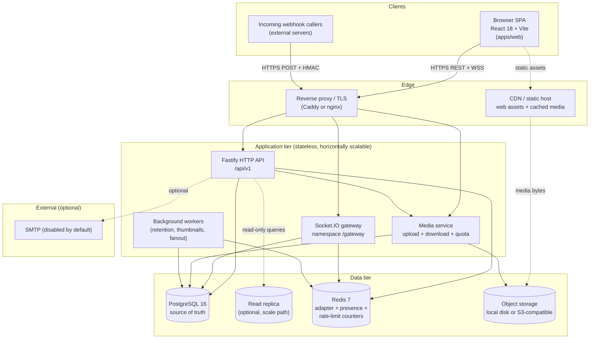
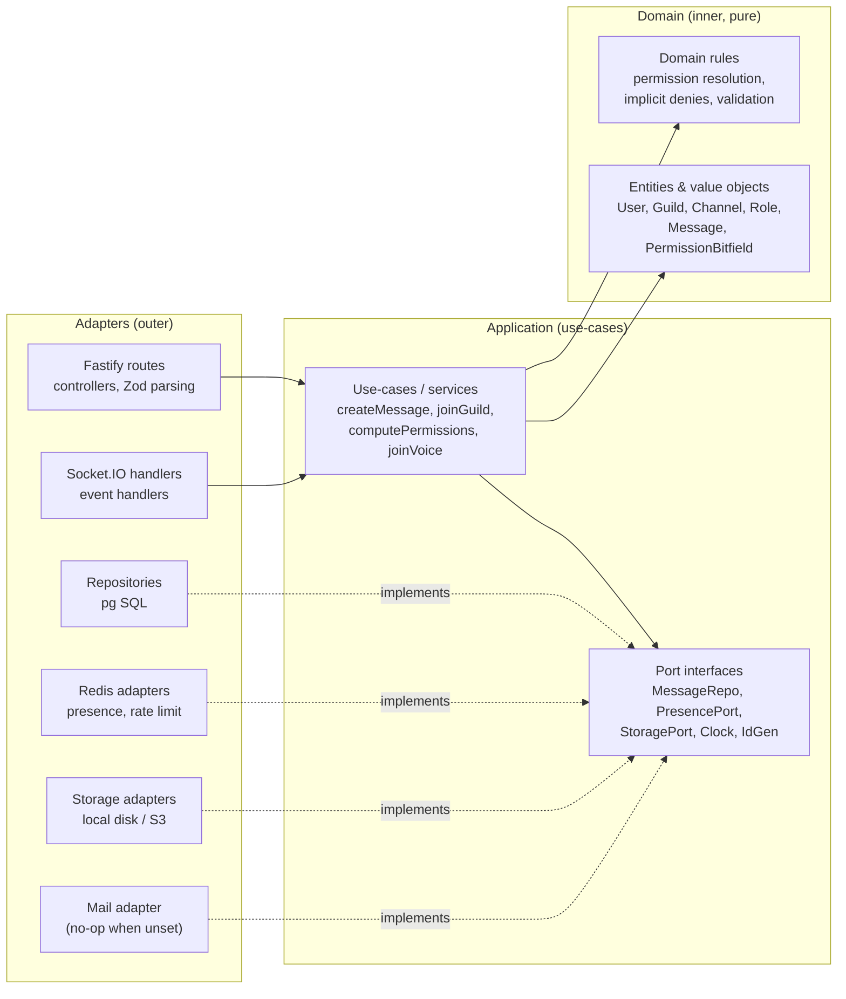
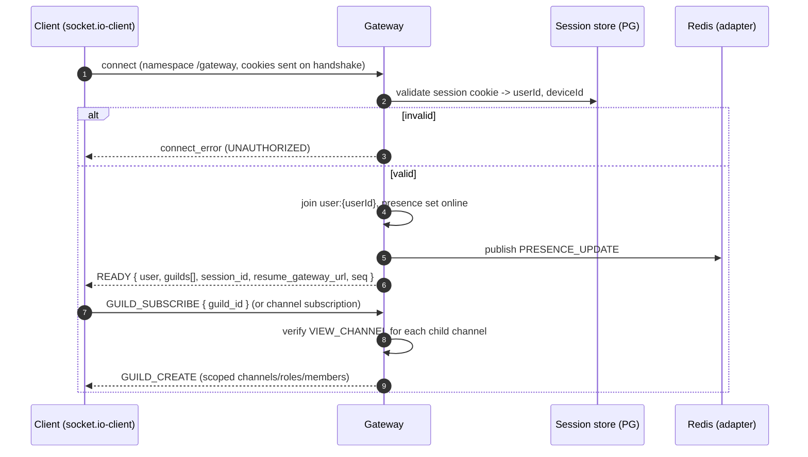
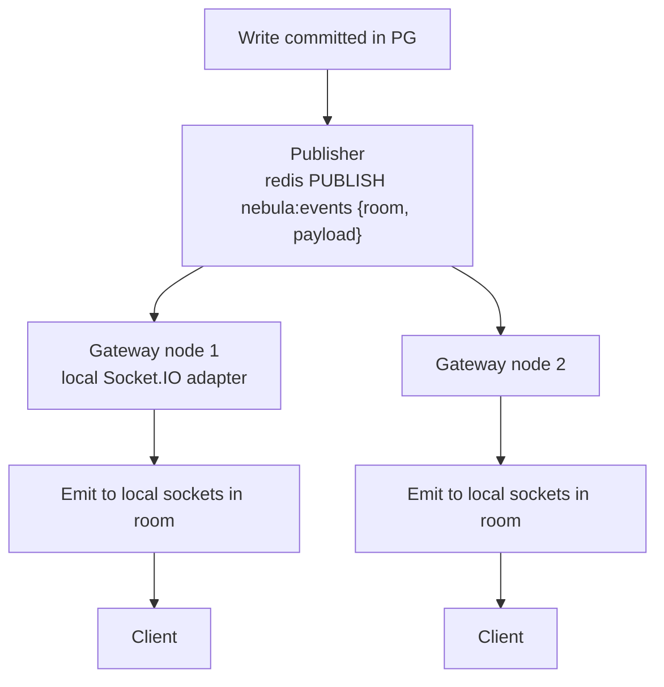
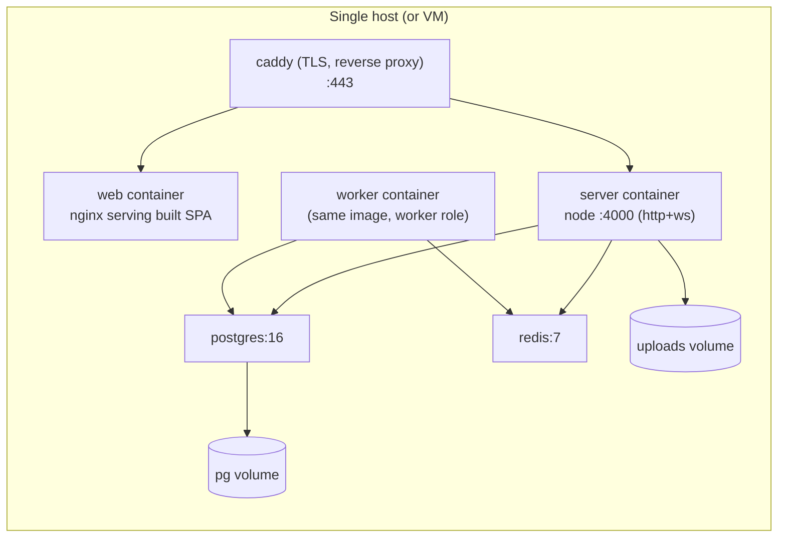

# Nebula — System Architecture

| Field | Value |
| --- | --- |
| Document | SYSTEM_ARCHITECTURE.md |
| Status | **Implemented** — the described components (Fastify API, Socket.IO gateway, Postgres/Redis, mesh voice) exist and run; gaps (SFU, TURN, multi-node) are listed in [FINAL_ACCEPTANCE_REPORT.md](./FINAL_ACCEPTANCE_REPORT.md) |
| Version | 0.1.0 |
| Last updated | 2026-10-17 |

> Status note: everything here is the **designed** architecture. No services are running. Where a Discord behavior is relied upon it is marked **[VERIFIED]**; independent choices are **[DESIGN]**.

---

## 1. Overview

Nebula is a monorepo with three workspaces:

- **`apps/server`** (`@nebula/server`) — Node.js 22 + Fastify 5 HTTP API, Socket.IO 4 gateway, Postgres 16 (raw SQL via `pg`), Redis 7 (Socket.IO adapter, presence, rate-limit counters), Zod validation, `scrypt` auth, media storage.
- **`apps/web`** (`@nebula/web`) — React 18 + Vite 6 + TypeScript + Tailwind 3 + Zustand + `socket.io-client` + `react-router-dom` + `lucide-react`.
- **`packages/shared`** (`@nebula/shared`) — pure, dependency-light domain contracts: snowflake helpers, permission bitfield + computation, Zod schemas, event enums/payload types, error codes.

Design rule: **REST for state-changing writes, the Socket.IO gateway for server→client dispatch.** Writes are committed to Postgres, then fanned out via Redis pub/sub. The gateway is not a write path for messages (except a small set of realtime-only signals: typing, presence, voice signaling, read-state).

---

## 2. Component diagram



Notes:
- **Stateless app tier.** All session state is in Postgres; all presence/rate-limit/adapter state is in Redis; all media in object storage. Any node can serve any request.
- **Single write primary.** Only the primary accepts writes; read replicas serve read-heavy dashboards later.
- **Workers** are the same codebase launched with a different entrypoint (a worker role), so no separate package.

---

## 3. Module boundaries (domain → application → adapters)

The server is a **hexagonal / ports-and-adapters** layout. Dependencies point inward only.



**Layer rules (enforced by lint import boundaries):**

| Layer | May import | Must not import |
| --- | --- | --- |
| `domain` | nothing outside `domain` (pure TS, `@nebula/shared` only) | Fastify, pg, Redis, Socket.IO, Node fs |
| `application` | `domain`, `@nebula/shared`, port interfaces | concrete adapters, Fastify, pg |
| `adapters` | `application`, `domain`, `@nebula/shared`, libraries | other adapters (except via composition root) |
| `composition root` (`server.ts`) | everything | — |

`packages/shared` is the **contract** between server and web. It contains no I/O. The permission module lives here so the UI can *display* what the server *enforces*.

**Server directory sketch (planned):**
```
apps/server/src/
  domain/            # entities + rules (pure)
  application/       # use-cases + ports
  adapters/
    http/            # routes, schemas, error mapping, CSRF, rate limit
    realtime/        # socket.io server, handlers, dispatch, rooms
    persistence/     # pg repositories, migrations runner
    cache/           # redis presence, rate limits
    storage/         # local + s3 drivers
    mail/            # smtp driver (no-op default)
  worker/            # background jobs entrypoint
  composition/       # wiring, config (Zod), logger, shutdown
  server.ts          # HTTP + gateway bootstrap
```

---

## 4. Request lifecycle (HTTP write, e.g. send message)

```mermaid
sequenceDiagram
  autonumber
  participant B as Browser (web)
  participant P as Proxy/TLS
  participant A as Fastify API
  participant MW as Middleware chain
  participant UC as Use-case (createMessage)
  participant DB as PostgreSQL
  participant R as Redis (pub/sub)
  participant G as Gateway node(s)
  participant C as Subscribed clients

  B->>P: POST /api/v1/channels/{id}/messages (cookie + X-CSRF-Token)
  P->>A: forwarded request
  A->>MW: requestId, structured log, body parse, Zod validate
  MW->>MW: session lookup (cookie) + CSRF check (unsafe method)
  MW->>MW: rate-limit check (per-user, per-route, global) via Redis
  MW->>UC: authorize + hydrate context (guild, channel, member, base perms)
  UC->>UC: compute channel permissions (base -> ADMIN -> overwrites -> implicit -> timeout)
  alt missing SEND_MESSAGES
    UC-->>A: PermissionError
    A-->>B: 403 MISSING_PERMISSIONS (no write)
  else allowed
    UC->>DB: BEGIN; insert message (snowflake id, nonce dedup); COMMIT
    UC->>UC: parse mentions, build message DTO
    UC->>R: PUBLISH channel:{id} MESSAGE_CREATE
    UC-->>A: message DTO
    A-->>B: 201 message JSON
    R-->>G: fan-out to every node's subscribers
    G->>G: scope: only members with VIEW_CHANNEL/READ_MESSAGE_HISTORY
    G-->>C: MESSAGE_CREATE
  end
```

**Middleware chain order (fixed):**
1. `requestId` + `onRequest` structured log start
2. Cookie parse
3. Body/content-type handling (JSON or multipart)
4. Zod schema validation (reject 400 `VALIDATION_ERROR` with field details)
5. Session hydration (`GET /users/@me`-style context; anonymous allowed only on public routes)
6. CSRF verification for `POST/PUT/PATCH/DELETE` on cookie auth (`403 CSRF_FAILED`)
7. Rate limit (per-route bucket + global bucket)
8. Route handler → use-case
9. Centralised error mapper → stable error envelope
10. `onResponse` metric + log including `duration_ms`

**Every write path re-validates authorization**; the client's cached permission set is never trusted.

---

## 5. Real-time event flow (Socket.IO)

### 5.1 Connection & identify



### 5.2 Dispatch & fan-out



**Room strategy [DESIGN]:**
- `user:{userId}` — personal events (DMs, friend requests, notifications, read state).
- `guild:{guildId}` — guild-scoped control events (channels, roles, member add/remove).
- `channel:{channelId}` — message/reaction/typing fan-out, joined **only** after a `VIEW_CHANNEL` check.
- `voice:{channelId}` — voice state + signaling, joined only with `CONNECT`.

**Authorization is applied at fan-out, not just at join.** A user who loses `VIEW_CHANNEL` (overwrite change, role change, timeout) is explicitly removed from the room and receives `CHANNEL_DELETE`-style removal semantics. **[DESIGN]**

### 5.3 Ordering, resume, and duplicates
- Every dispatched event carries `seq` (a per-connection monotonic counter) and the entity's snowflake `id`.
- Clients order messages by snowflake `id` ascending (time-sortable) — **[DESIGN]** consistent with §6 of the product spec.
- On reconnect, the client sends `RESUME { session_id, last_seq }`; the server replays buffered events for that user from a bounded Redis stream (window configurable, default last 5 minutes / 1000 events) or instructs a full `READY`. **[DESIGN]**
- Idempotency: writes accept a client `nonce`; the `(channel_id, author_id, nonce)` unique index collapses retries.

### 5.4 Backpressure
- Per-socket outbound queue with a high-water mark; typing/presence events are coalesced and dropped under pressure (they are ephemeral), while message events are never dropped.
- Slow consumers are disconnected after a threshold rather than allowed to exhaust node memory. **[DESIGN]**

---

## 6. Data flow

### 6.1 System of record vs ephemeral

| Data | Store | Durability | Reconstructable |
| --- | --- | --- | --- |
| Users, guilds, channels, roles, messages, attachments metadata, audit log, invites, webhooks, relationships | PostgreSQL | Durable | — (source of truth) |
| Sessions | PostgreSQL | Durable (TTL) | — |
| Presence (online/idle/dnd), typing, rate-limit counters, adapter pub/sub, resume buffer | Redis | Ephemeral | Yes — rebuilt from connections/events |
| Media bytes | Object storage (disk/S3) | Durable | Backed up with the DB |

### 6.2 Write→read consistency
- Message insert and its fan-out are **transactionally ordered**: commit first, publish after. A crash between commit and publish leaves the message persisted; the recipient fetches it on next page load (at-least-once delivery, deduplicated client-side by snowflake id).
- Read-after-write within a single node is immediate (primary reads). Replica reads (future) may lag and are only used for non-critical dashboards.

### 6.3 Presence flow
- Connect → `SET presence:{userId} {status, sessions} EX ttl`; heartbeat refreshes.
- Multi-session: presence value holds a set of session ids; `online` if ≥1 non-idle session.
- Disconnect → remove session; if set empty, `offline` and publish `PRESENCE_UPDATE`.
- A Redis miss (eviction/restart) falls back to Postgres `last_known_presence` and re-derives from live sockets. **[DESIGN]**

---

## 7. Failure handling

| Failure | Detection | Response |
| --- | --- | --- |
| Postgres primary down | pool connect errors, health check | `/readyz` fails; API returns `503 DATABASE_UNAVAILABLE`; writes refused fast; gateway keeps existing sockets but disables writes |
| Redis down | ping failures | presence/rate-limit degrade: rate limiting fails **closed** on sensitive routes (login/register) and **open-with-logging** on benign routes **[DESIGN]**; Socket.IO adapter failures retry with backoff; single-node still functions |
| Object storage down | write/read errors | uploads return `503 STORAGE_UNAVAILABLE`; existing metadata preserved; downloads 502 |
| Gateway node crash | LB health check | clients reconnect (Socket.IO) to another node; sessions live in PG so `READY` succeeds; resume buffer best-effort |
| Publish lost | periodic reconciliation | clients detect gaps via `seq` and request a scoped re-sync |
| Slow client | outbound queue depth | coalesce/drop ephemeral events; disconnect abusive consumers |
| Migration failure | migration runner | abort, do not start server on mismatched schema version |
| Clock skew / duplicate snowflake | ID generator | node refuses to start if worker id collides; waits for next ms on overflow |

**Graceful shutdown** (SIGTERM): stop accepting new HTTP; send `CLOSE` to sockets; flush logs/metrics; drain in-flight requests (timeout 10 s); close Redis + PG pools.

---

## 8. Scaling strategy

### 8.1 Horizontal HTTP + gateway
- App nodes are stateless behind a load balancer with sticky sessions **not required** for HTTP; Socket.IO long-polling needs stickiness or a Redis adapter (the adapter is always on).
- The **Redis adapter** broadcasts Socket.IO events across nodes so a message published by node A reaches a client connected to node B.
- Add nodes linearly; throughput ceiling is Postgres writes and Redis pub/sub.

### 8.2 Database
- Primary handles writes; **read replicas** serve read-only, non-authoritative views (search indexing reads, analytics, large member lists) with an accepted lag.
- Indexes tuned for the hot paths: messages by `(channel_id, id)`, guild members by `(guild_id, user_id)`, relationships, read states.
- Partitioning path for `messages` by time/range is documented but not enabled in the slice.

### 8.3 Media/CDN
- Uploads written to object storage; downloads proxied by the media service (auth check) which may redirect to a **signed, short-lived CDN URL** for large/static assets. **[DESIGN]**
- The auth check still happens at the origin; signed URLs are scoped and expiring.

### 8.4 Voice scaling
- **Slice:** WebRTC **mesh** (each participant connected to every other). Cap ~8; quality degrades as O(n²) streams. **[DESIGN]**
- **Documented path (not built):** introduce an **SFU** (mediasoup or LiveKit); the client's signaling abstraction is designed so switching to an SFU changes the signaling layer, not the UI. This is a stated limitation, not implemented.

### 8.5 What is *not* scaled
Single-region; no active-active multi-region; no sharded Postgres; no custom gateway protocol (Socket.IO, not a bespoke WebSocket gateway).

---

## 9. Deployment architecture

### 9.1 Local development
`docker-compose.yml` provides Postgres 16 on `127.0.0.1:55432` and Redis 7 on `127.0.0.1:56379`. The server runs on `:4000`, the Vite dev server on `:5173`, proxying `/api` and `/gateway` to the server.

### 9.2 Container topology (single node default)



- **Images:** multi-stage Dockerfiles per app; server image is also run as the worker with `NEBULA_ROLE=worker`.
- **Config:** all via env (`.env.example` is the contract: `PORT`, `DATABASE_URL`, `REDIS_URL`, `SESSION_SECRET`, `COOKIE_SECURE`, `STORAGE_DRIVER`, `STORAGE_LOCAL_DIR`, `MAX_UPLOAD_BYTES`, `STORAGE_QUOTA_BYTES_PER_GUILD`, `RATE_LIMIT_DISABLED`, `SMTP_URL`, `VITE_API_ORIGIN`).
- **Migrations:** run as an init step (or a one-shot `migrate` command) before the server starts; the server refuses to boot on schema mismatch.
- **Multi-node path:** run N `server` containers behind the proxy, all sharing Postgres + Redis + object storage; enable read replicas when read load dominates.

---

## 10. Observability

### 10.1 Structured logging
- JSON logs (pino) with `level`, `time`, `request_id`, `user_id?`, `guild_id?`, `route`, `status`, `duration_ms`, `event?`.
- **Redaction** by default: cookies, `authorization`, `X-CSRF-Token`, passwords, message content, email (hashed/truncated). Content logging requires an explicit opt-in debug flag and is never on in production.
- Real-time logs include `socket_id`, `event`, and `seq` for tracing fan-out.

### 10.2 Metrics (Prometheus-style `/metrics`)
- HTTP: request counters by route/status, latency histograms, inflight gauge.
- Gateway: connected sockets, events/sec by type, outbound queue depth, reconnect rate, resume success/failure.
- DB: pool in-use/idle, query durations (also `pg_stat_statements`).
- Redis: op latency, pub/sub throughput.
- Domain: messages created, uploads bytes, quota rejections, permission denials (as a security signal — a spike can indicate enumeration).
- Voice: active calls, participants, ICE failure rate.

### 10.3 Health & readiness
- `GET /healthz` — liveness: process up (no dependency check).
- `GET /readyz` — readiness: Postgres `SELECT 1`, Redis `PING`, storage writable, schema version matches; returns `503` with a component breakdown when not ready.

### 10.4 Tracing
- `request_id` propagated from HTTP into the use-case, the DB query tags, the Redis publish, and the realtime event so a single message can be traced from POST to every subscriber. OpenTelemetry is a documented extension, not a slice requirement. **[DESIGN]**

---

## 11. Technology decisions & rationale (summary)

| Decision | Choice | Rationale |
| --- | --- | --- |
| Realtime transport | Socket.IO 4 | rooms, reconnect, adapters, familiar client; documented limitation vs a bespoke gateway |
| Writes vs dispatch | REST writes, gateway dispatch | simple authorization/validation in one place; avoids dual write paths |
| Permissions | recompute server-side everywhere | client display ≠ enforcement; documented computation order |
| IDs | snowflake BigInt as string | time-sortable, cursor-friendly, no auto-increment collisions |
| Media | storage port (local/S3) | self-hostable default, deployable to S3 later |
| Voice | mesh now, SFU documented | honest scope; smaller real slice beats a stub SFU |
| Search | Postgres FTS | no extra infra; documented operator subset |
| Presence | Redis ephemeral | presence is inherently volatile; no durable row churn |

---

## 12. Uncertainty / open items

- **[UNKNOWN]** Exact Socket.IO adapter behavior under node restart for in-flight long-polling upgrades is not yet validated; reconnect tests will pin behavior.
- **[DESIGN OPEN]** Resume-buffer bounds (time vs count) and whether gaps trigger partial vs full resync.
- **[DESIGN OPEN]** Rate-limit fail-open vs fail-closed policy per route.
- **[DESIGN OPEN]** Whether the proxy terminates TLS for WebSockets directly or via `sticky` routing (not expected to be needed with the Redis adapter, but unverified).
